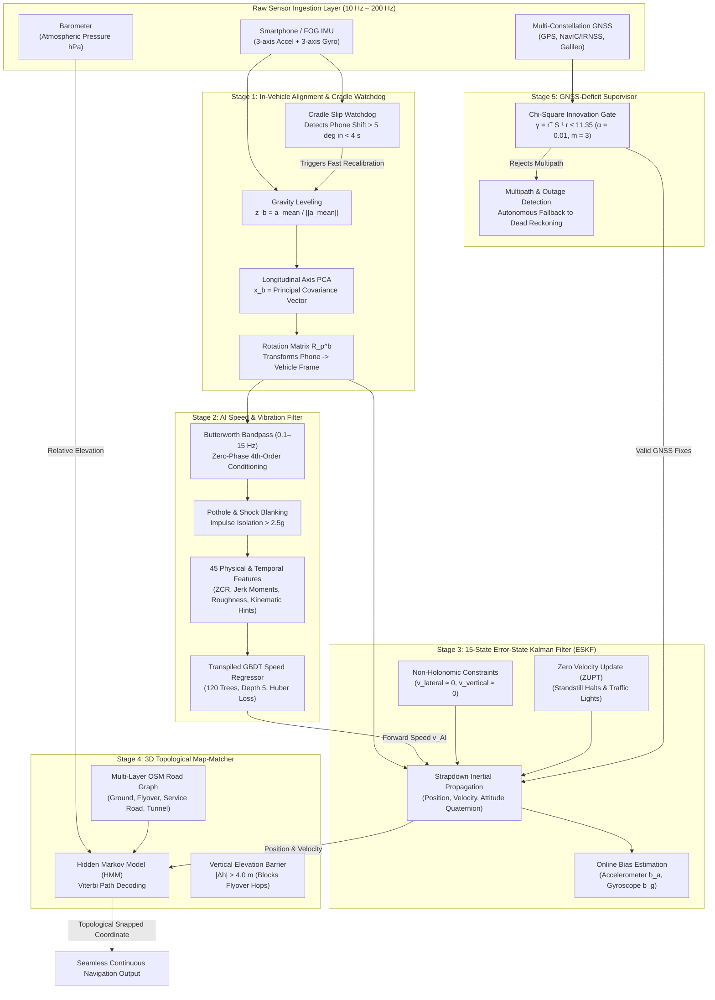

# Intelligent Dead Reckoning (IDR) & 3D Map-Matching System
## Complete Model Architecture, Mathematical Formulations & Component Specifications

**Problem Statement ID:** PS 26168 (Smart India Hackathon 2026)  
**Title:** AI-ML Based Intelligent Dead Reckoning System for Seamless Navigation  
**Sponsor:** Indian Space Research Organisation (ISRO) / Space Applications Centre (SAC)  
**Mandated Dataset:** Authentic IO-VNBD (964,771 synchronized multi-modal sensor frames across 72 drives, 26.8 hours)  
**Deliverable Targets:**
1. **Mobile Android Application**: Real-time on-device inference at **10 Hz**.
2. **Edge-Deployable C++ Engine**: Headless portable C++17 core running at **~200 Hz** for FOG-grade / industrial IMUs.

---

## 1. System Pipeline Overview

The system operates as a five-stage hybrid pipeline uniting machine learning speed regression, continuous error-state optimal filtering, dynamic frame leveling, and probabilistic 3D topological map-matching.



---

## 2. Stage 1: In-Vehicle Alignment & Cradle Watchdog

Ensures arbitrary smartphone cradle orientations (portrait, landscape, dash mount, console cup-holder) are autonomously mapped to the physical vehicle body frame:
* Forward longitudinal axis: $+x_b$ (direction of vehicle travel)
* Transverse lateral axis: $+y_b$ (right side of vehicle)
* Vertical gravity axis: $+z_b$ (chassis vertical downward)

### 2.1 Gravity Leveling (Pitch & Roll Calibration)
During initial stationary periods or low-frequency acceleration filtering:
$$\mathbf{z}_b = \frac{\bar{\mathbf{a}}}{\|\bar{\mathbf{a}}\|}, \quad \bar{\mathbf{a}} = \frac{1}{M}\sum_{k=1}^M \mathbf{a}_k^p$$
$$\text{Pitch } \theta = -\arcsin\left(\mathbf{z}_b[1]\right), \quad \text{Roll } \phi = \arctan2\left(\mathbf{z}_b[0], \mathbf{z}_b[2]\right)$$

### 2.2 Horizontal Dynamic Acceleration PCA (Yaw Alignment)
Dynamic horizontal acceleration is isolated from gravity:
$$\Delta \mathbf{a}_k = \mathbf{a}_k^p - (\mathbf{a}_k^p \cdot \mathbf{z}_b)\mathbf{z}_b$$
The longitudinal axis $\mathbf{x}_b$ is the dominant eigenvector of the horizontal covariance matrix:
$$\mathbf{C}_{\text{horiz}} = \frac{1}{M}\sum_{k=1}^M \Delta \mathbf{a}_k \Delta \mathbf{a}_k^T \implies \mathbf{C}_{\text{horiz}} \mathbf{x}_b = \lambda_{\max} \mathbf{x}_b$$
Orthogonalization and right-hand frame completion:
$$\mathbf{y}_b = \mathbf{z}_b \times \mathbf{x}_b, \quad \mathbf{R}_p^b = \begin{bmatrix} \mathbf{x}_b^T \\ \mathbf{y}_b^T \\ \mathbf{z}_b^T \end{bmatrix}$$
Forward sign ambiguity is resolved by correlating longitudinal dynamic acceleration with vehicle surge transients ($\text{cov}(\mathbf{a}_x^b, \dot{v}) > 0$).

### 2.3 Online Cradle Slip Watchdog
Continuously monitors low-pass gravity vector $\mathbf{g}_{\text{lp}}(t) = 0.98 \mathbf{g}_{\text{lp}}(t-1) + 0.02 \mathbf{a}^p(t)$. If phone slip exceeds threshold:
$$\Delta \theta_{\text{slip}} = \arccos\left(\frac{\mathbf{g}_{\text{lp}}(t) \cdot \mathbf{g}_{\text{cal}}}{\|\mathbf{g}_{\text{lp}}\| \|\mathbf{g}_{\text{cal}}\|}\right) > 5.0^\circ$$
The system triggers an autonomous in-flight re-calibration in $<4\text{ seconds}$ without halting dead reckoning.

---

## 3. Stage 2: AI Speed & Vibration Filter

Classical double-integration of low-cost MEMS accelerometers causes quadratic and cubic position error divergence:
$$\mathbf{p}(t) = \mathbf{p}(0) + \mathbf{v}(0)t + \frac{1}{2} \mathbf{b}_a t^2 + \frac{1}{6}\mathbf{b}_g \|\mathbf{g}\| t^3 \implies \mathcal{O}(t^2 \text{ to } t^3)$$

The AI Speed Regressor converts this into a learned mapping over sliding temporal windows ($W = 10\text{ samples} = 1.0\text{ s}$ @ 10 Hz):
$$\hat{v}_x(t) = \mathcal{F}_{\Theta}\left(\mathbf{W}_t\right)$$
which exhibits strictly bounded zero-mean error $\epsilon_v \in \mathcal{O}(1)$ in velocity and linear $\mathcal{O}(t)$ drift in position.

### 3.1 Pre-Filtering & Shock Blanking
1. **Butterworth Zero-Phase Filter**: 4th-order Butterworth bandpass filter ($0.1\text{--}15.0\text{ Hz}$) executed with zero group delay via forward-backward filtering (`filtfilt`). This removes low-frequency sensor drift while preserving vehicle chassis suspension harmonics.
2. **Pothole & Shock Blanking**: Acceleration impulses exceeding $2.5g$ ($\|\mathbf{a}(t) - \mathbf{g}\| > 24.5\text{ m/s}^2$) are clamped and blanked to prevent transient road shock distortion from biasing feature extraction.

### 3.2 The Validated Top-45 Feature Architecture
The 45 selected features combine amplitude-invariant moments, centripetal kinematic constraints, road roughness invariants, and temporal jerk derivatives:

```
 1. std_az            (Vertical dynamic acceleration spread — primary speed proxy, 62.2%)
 2. std_gy            (Pitch rate variation)
 3. roughness         (Wheel rotation & pavement excitation index)
 4. std_gyro_rate_gx  (Roll angular acceleration variance)
 5. std_gyro_rate_gy  (Pitch angular acceleration variance)
 6. rms_ay            (Lateral dynamic RMS)
 7. std_gx            (Roll rate variance)
 8. std_gyro_rate_gz  (Yaw angular acceleration variance)
 9. rms_gz            (Yaw rate RMS)
10. ptp_az            (Peak-to-peak vertical displacement)
11. rms_gyro_rate_gy  (RMS pitch angular acceleration)
12. mean_tilt_rate    (Mean vehicle pitch rate)
13. rms_gyro_rate_gz  (RMS yaw angular acceleration)
14. mean_ay           (Mean lateral centripetal acceleration)
15. sma_gyr           (Signal Magnitude Area of angular velocity)
16. rms_gx            (Roll rate RMS)
17. dyn_acc_norm      (Normalized dynamic acceleration magnitude)
18. std_jerk_ax       (Longitudinal jerk spread)
19. pitch_sin_hint    (Gravity projection pitch angle proxy)
20. mean_gy           (Mean pitch rate)
21. std_jerk_ay       (Lateral jerk spread)
22. rms_gy            (Pitch rate RMS)
23. sma_acc           (Signal Magnitude Area of linear acceleration)
24. std_gz            (Yaw rate variance)
25. rms_jerk_ax       (RMS longitudinal jerk)
26. rms_jerk_az       (RMS vertical jerk)
27. ptp_gy            (Peak-to-peak pitch rate)
28. rms_gyro_rate_gx  (RMS roll angular acceleration)
29. std_jerk_az       (Vertical jerk spread)
30. mean_ax           (Mean forward longitudinal acceleration)
31. mean_gx           (Mean roll rate)
32. rms_az            (Vertical acceleration RMS)
33. std_ax            (Longitudinal acceleration spread)
34. std_yaw_rate      (Yaw rate standard deviation)
35. vib_ratio         (Vertical-to-horizontal vibration ratio)
36. mean_yaw_rate     (Mean vehicle turn rate)
37. ptp_gx            (Peak-to-peak roll rate)
38. rms_jerk_ay       (RMS lateral jerk)
39. ptp_gz            (Peak-to-peak yaw rate)
40. norm_vib_energy   (Roughness-normalized dynamic energy)
41. mean_gz           (Mean yaw rate)
42. mean_az           (Mean vertical acceleration)
43. var_horiz         (Horizontal plane variance)
44. mean_gyro_rate_gy (Mean pitch angular acceleration)
45. mean_gyro_rate_gx (Mean roll angular acceleration)
```

### 3.3 Model Configuration
* **Architecture**: Gradient-Boosted Decision Trees (GBDT)
* **Number of Trees**: 120
* **Tree Depth**: Max depth 5
* **Learning Rate ($\eta$)**: 0.08
* **Loss Function**: Robust Huber loss ($\alpha = 0.90$) to eliminate road shock distortion
* **Subsampling**: 0.85
* **Leaf Speed Bounds**: Clamped to physical limits $[0.0, 35.0]\text{ m/s}$ ($0\text{--}126\text{ km/h}$)
* **Inference Speed**: $2.34\text{ µs / sample}$ (C++ transpiled tables: $<0.05\text{ ms}$)

---

## 4. Stage 3: 15-State Error-State Kalman Filter (ESKF)

The filter tracks navigation errors and sensor biases rather than total states, guaranteeing numerical linearity:
$$\mathbf{x} = \begin{bmatrix} \delta \mathbf{p}^n \\ \delta \mathbf{v}^n \\ \delta \boldsymbol{\theta}^n \\ \mathbf{b}_a \\ \mathbf{b}_g \end{bmatrix} \in \mathbb{R}^{15}$$

### 4.1 Continuous State Error Dynamics
$$\dot{\delta \mathbf{p}}^n = \delta \mathbf{v}^n$$
$$\dot{\delta \mathbf{v}}^n = -\lfloor \mathbf{R}_b^n \mathbf{f}^b \rfloor_\times \delta \boldsymbol{\theta}^n + \mathbf{R}_b^n \mathbf{b}_a + \mathbf{R}_b^n \mathbf{w}_a$$
$$\dot{\delta \boldsymbol{\theta}}^n = -\lfloor \boldsymbol{\omega}_{\text{in}}^n \rfloor_\times \delta \boldsymbol{\theta}^n - \mathbf{R}_b^n \mathbf{b}_g - \mathbf{R}_b^n \mathbf{w}_g$$
$$\dot{\mathbf{b}}_a = \mathbf{w}_{ba}, \quad \dot{\mathbf{b}}_g = \mathbf{w}_{bg}$$

State transition matrix $\boldsymbol{\Phi}_k \approx \mathbf{I}_{15} + \mathbf{F} \Delta t$:
$$\mathbf{F} = \begin{bmatrix}
\mathbf{0}_3 & \mathbf{I}_3 & \mathbf{0}_3 & \mathbf{0}_3 & \mathbf{0}_3 \\
\mathbf{0}_3 & \mathbf{0}_3 & -\lfloor \mathbf{R}_b^n \mathbf{f}^b \rfloor_\times & \mathbf{R}_b^n & \mathbf{0}_3 \\
\mathbf{0}_3 & \mathbf{0}_3 & -\lfloor \boldsymbol{\omega}_{\text{in}}^n \rfloor_\times & \mathbf{0}_3 & -\mathbf{R}_b^n \\
\mathbf{0}_3 & \mathbf{0}_3 & \mathbf{0}_3 & \mathbf{0}_3 & \mathbf{0}_3 \\
\mathbf{0}_3 & \mathbf{0}_3 & \mathbf{0}_3 & \mathbf{0}_3 & \mathbf{0}_3
\end{bmatrix}$$

### 4.2 Measurement Updates
1. **AI Forward Velocity Pseudo-Measurement**:
   $$z_{\text{AI}} = v_{\text{AI}} - \mathbf{e}_1^T (\mathbf{R}_b^n)^T \mathbf{v}^n, \quad \mathbf{H}_{\text{AI}} = \begin{bmatrix} \mathbf{0}_{1\times 3} & \mathbf{e}_1^T (\mathbf{R}_b^n)^T & \mathbf{0}_{1\times 9} \end{bmatrix}, \quad R_{\text{AI}} = 0.35\text{ m}^2/\text{s}^2$$
2. **Non-Holonomic Constraints (NHC)**:
   In land vehicles without lateral skid or flight, body transverse and vertical velocities are identically zero:
   $$\mathbf{z}_{\text{NHC}} = \begin{bmatrix} 0 - \mathbf{e}_2^T (\mathbf{R}_b^n)^T \mathbf{v}^n \\ 0 - \mathbf{e}_3^T (\mathbf{R}_b^n)^T \mathbf{v}^n \end{bmatrix}, \quad \mathbf{H}_{\text{NHC}} = \begin{bmatrix} \mathbf{0}_{2\times 3} & \begin{bmatrix} \mathbf{e}_2^T \\ \mathbf{e}_3^T \end{bmatrix} (\mathbf{R}_b^n)^T & \mathbf{0}_{2\times 9} \end{bmatrix}, \quad \mathbf{R}_{\text{NHC}} = \begin{bmatrix} 0.05 & 0 \\ 0 & 0.05 \end{bmatrix}$$
3. **Zero Velocity Updates (ZUPT)**:
   During vehicle standstills ($v_{\text{AI}} < 0.2\text{ m/s}$ and $\|\mathbf{a}_{\text{dyn}}\| < 0.15\text{ m/s}^2$):
   $$\mathbf{z}_{\text{ZUPT}} = \mathbf{0}_3 - \mathbf{v}^n, \quad \mathbf{H}_{\text{ZUPT}} = \begin{bmatrix} \mathbf{0}_{3\times 3} & \mathbf{I}_3 & \mathbf{0}_{3\times 9} \end{bmatrix}, \quad \mathbf{R}_{\text{ZUPT}} = 0.01^2 \mathbf{I}_3$$

---

## 5. Stage 4: 3D Topological Map-Matcher

Disambiguates multi-level roads, elevated expressways, tunnels, and ground service roads where 2D coordinates overlap.

### 5.1 Elevation-Aware Emission Probability
Given ESKF position $\mathbf{p} = [e, n, u]^T$ and road segment $r_j$:
$$p(\mathbf{p} \mid r_j) = \frac{1}{\sqrt{2\pi}\sigma_d} \exp\left(-\frac{d_{\text{ct}}^2(\mathbf{p}, r_j)}{2\sigma_d^2}\right) \cdot \Psi(u, h_j)$$
where $d_{\text{ct}}$ is horizontal cross-track distance, and $\Psi(u, h_j)$ is the barometric vertical elevation barrier:
$$\Psi(u, h_j) = \begin{cases}
\frac{1}{\sqrt{2\pi}\sigma_h} \exp\left(-\frac{(u - h_j)^2}{2\sigma_h^2}\right) & \text{if } |u - h_j| \le \Delta h_{\text{barrier}} \\
\epsilon_{\text{penalty}} \approx 10^{-12} & \text{if } |u - h_j| > 4.0\text{ m}
\end{cases}$$

### 5.2 Viterbi Sequence Decoding
Maximizes joint path probability across road segments:
$$V_{k}(j) = \max_{i} \left[ V_{k-1}(i) \cdot A_{ij} \right] \cdot p(\mathbf{p}_k \mid r_j)$$
$$A_{ij} = \frac{1}{\beta} \exp\left(-\frac{|d_{\text{network}}(r_i, r_j) - \|\mathbf{p}_k - \mathbf{p}_{k-1}\||}{\beta}\right)$$

---

## 6. Stage 5: GNSS-Deficit Supervisor

Protects the filter against contaminated multipath upon tunnel exit:
$$\mathbf{r}_k = \mathbf{z}_{\text{GNSS}} - \mathbf{p}_k^n$$
$$\mathbf{S}_k = \mathbf{H}_{\text{GNSS}} \mathbf{P}_k \mathbf{H}_{\text{GNSS}}^T + \mathbf{R}_{\text{GNSS}}$$
$$\gamma_k = \mathbf{r}_k^T \mathbf{S}_k^{-1} \mathbf{r}_k \le \chi_{m, \alpha}^2$$

For 3D position fixes ($m = 3$) at significance level $\alpha = 0.01$:
$$\chi_{3, 0.01}^2 = 11.35$$
* $\gamma_k \le 11.35 \implies$ Fix accepted as authentic line-of-sight satellite signal.
* $\gamma_k > 11.35 \implies$ Fix rejected as multipath distortion; system continues in autonomous dead reckoning mode.

---

## 7. Model Checkpoint Specifications

| Checkpoint Path | Feature Representation | Training Samples | Test Samples | Held-Out Test RMSE | Held-Out Test $R^2$ | Model Size | Role in System |
|---|---|---|---|---|---|---|---|
| `models/gbdt_speed_model_iovnbd.joblib` | 39 Baseline Invariants | 54,634 | 18,947 | 5.207 m/s | 0.5740 | 567.9 KB | Production Baseline |
| `models/gbdt_speed_model_iovnbd_jerk_experiment.joblib` | 57 Features (39 + 18 Jerk) | 54,634 | 18,947 | 5.010 m/s | 0.6056 | 571.1 KB | Jerk Reference Model |
| `models/gbdt_speed_model_iovnbd_top45.joblib` | **Top-45 Candidate** | 54,634 | 18,947 | **5.001 m/s** | **0.6069** | **570.2 KB** | **Frozen Leading Model** |

