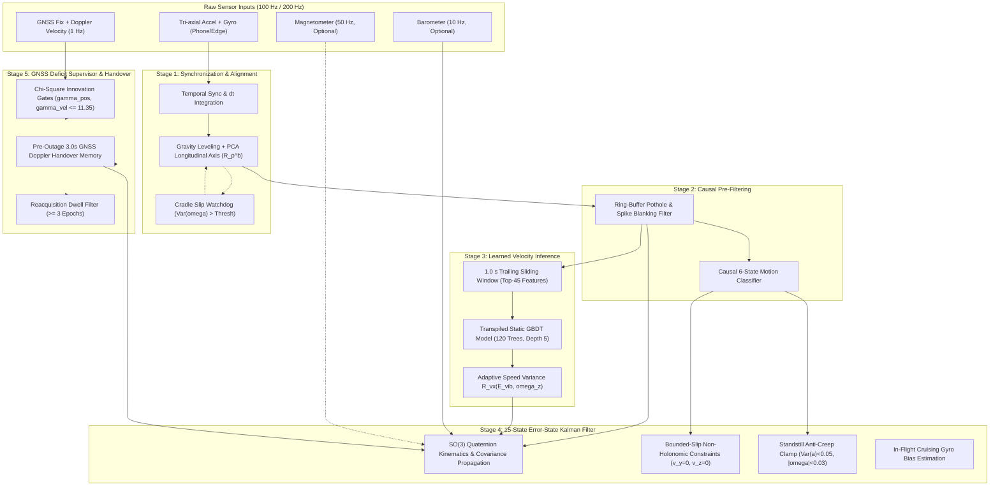

# PART 1 ARCHITECTURE SPECIFICATION
## SIH 2026 / ISRO-SAC PS 26168: AI-ML Based Intelligent Dead Reckoning System

**Document Version:** 1.0.0  
**Phase:** Part 1 — Intelligent Autonomous Dead-Reckoning Core  
**Authoritative Baseline:** B1/N8 Autonomous Pipeline  
**Execution Environment:** C++17 (`idr-core/`), Python 3.14 (`src/`), Android NDK JNI Bridge (`android/app/src/main/cpp/`)  
**Strict Firewall Constraint:** Strictly 0 Ground-Truth speed / velocity / position / heading in outage inference.

---

## 1. System Overview & Core Objectives

The Intelligent Autonomous Dead-Reckoning Core is designed to provide continuous, high-precision vehicle navigation during GNSS outages (such as tunnels, urban canyons, flyovers, and underpasses) without requiring CAN bus / OBD-II odometer inputs.

The architecture decouples algorithmic dead reckoning into a portable, sample-rate-agnostic, zero-allocation C++17 core (`idr-core/`), wrapped for on-device Android smartphone execution (10 Hz inference) and high-rate embedded edge platforms (~200 Hz FOG-grade IMU streaming).

---

## 2. Sensor Ingestion & Timestamp Synchronization

### 2.1 Sample-Rate Agnostic Timing
The navigation core does not assume a fixed sample interval. Every incoming IMU packet carries a monotonically increasing nanosecond or second timestamp $t_k$. The step interval is computed dynamically:
$$\Delta t_k = t_k - t_{k-1}$$
A sanity guard clamps anomalous timestamps:
$$\Delta t_k \in [0.001\text{ s}, 0.200\text{ s}]$$

### 2.2 Coordinate Frames
1. **Phone Sensor Frame ($p$):** Tri-axial orthogonal frame aligned with the mobile device IMU package.
2. **Vehicle Body Frame ($b$):**
   - $x_b$: Forward along vehicle longitudinal driving axis.
   - $y_b$: Lateral toward vehicle right side.
   - $z_b$: Downward along the local vertical gravity vector.
3. **Local Navigation Frame ($n$):** Local Cartesian East-North-Up (ENU) or North-East-Down (NED).

---

## 3. In-Vehicle Alignment & Cradle Slip Watchdog

### 3.1 Gravity Leveling (Roll and Pitch)
When the vehicle is stationary (detected via GNSS Doppler velocity $< 0.1\text{ m/s}$ or IMU variance), the mean accelerometer vector $\bar{\mathbf{a}}_p = [\bar{a}_x, \bar{a}_y, \bar{a}_z]^T$ measures reaction to gravity $\mathbf{g}_n = [0, 0, -9.80665]^T$:
$$\phi_{\text{mount}} = \arctan2(\bar{a}_y, \bar{a}_z)$$
$$\theta_{\text{mount}} = \arctan2(-\bar{a}_x, \sqrt{\bar{a}_y^2 + \bar{a}_z^2})$$

### 3.2 Longitudinal Axis Identification (Yaw Alignment)
During initial vehicle forward acceleration bursts ($\bar{a}_{\text{long}} > 0.5\text{ m/s}^2$), Principal Component Analysis (PCA) on horizontal acceleration extracts the forward driving axis:
$$\psi_{\text{mount}} = \arctan2(a_{y,\text{horiz}}, a_{x,\text{horiz}})$$
The composite mounting rotation matrix $\mathbf{R}_p^b$ rotates phone-frame accelerations and angular rates into the vehicle body frame:
$$\mathbf{a}_b = \mathbf{R}_p^b \, \mathbf{a}_p, \quad \boldsymbol{\omega}_b = \mathbf{R}_p^b \, \boldsymbol{\omega}_p$$

### 3.3 Cradle Slip Watchdog
To handle phones slipping in windshield mounts during sharp turns or pothole impacts, the watchdog monitors angular rate variance over a sliding 200 ms window:
$$\sigma_\omega^2 = \frac{1}{N}\sum_{i=1}^N \|\boldsymbol{\omega}_{p,i} - \bar{\boldsymbol{\omega}}_p\|^2$$
If $\sigma_\omega^2 > 1.8\text{ rad}^2/\text{s}^2$ without corresponding vehicle acceleration, a mounting disturbance is flagged, triggering gravity re-leveling within $< 4.0\text{ s}$ without terminating dead-reckoning filter propagation.

---

## 4. Causal Vibration & Shock Blanking Filter

### 4.1 Rejection of Non-Causal Research Filtering
Offline zero-phase filtering (`scipy.signal.filtfilt`) uses future samples ($t > t_k$) and is **strictly prohibited** in the production navigation core.

### 4.2 Trailing Ring-Buffer Shock Filter
The production pre-filter maintains a causal 5-sample ring buffer ($L=5$, $50\text{ ms}$ delay). For each incoming sample $\mathbf{a}_b(t_k)$:
1. Trailing median $\mathbf{m}_k = \text{median}(\mathbf{a}_b(t_{k-4 \dots k}))$.
2. Trailing absolute deviation $d_k = \|\mathbf{a}_b(t_k) - \mathbf{m}_k\|$.
3. If $d_k > 3.5 \cdot \sigma_{\text{nominal}}$ (pothole or curb impact):
   $$\mathbf{a}_{\text{clean}}(t_k) = \mathbf{m}_k$$
   Otherwise:
   $$\mathbf{a}_{\text{clean}}(t_k) = \mathbf{a}_b(t_k)$$

---

## 5. Top-45 Feature Extraction & Transpiled GBDT Speed Estimator

### 5.1 Sliding Window Feature Extraction
A strictly trailing 1.0 s sliding window (100 samples at 100 Hz) buffers cleaned accelerations and angular rates:
$$\mathcal{W}_k = \{(\mathbf{a}_{\text{clean}}(t_i), \boldsymbol{\omega}_{\text{clean}}(t_i))\}_{i=k-99}^k$$

### 5.2 The 45 Top Discriminative Features
From the IO-VNBD dataset, the 45 most informative features are computed causally:
1. **Statistical Moments (18 features):** Mean, standard deviation, variance, skewness, kurtosis, peak-to-peak amplitude for $a_x, a_y, a_z, \omega_x, \omega_y, \omega_z$.
2. **Signal Magnitude Area (SMA) (3 features):**
   $$\text{SMA}_a = \frac{1}{100}\sum_{i=0}^{99} (|a_{x,i}| + |a_{y,i}| + |a_{z,i}|)$$
3. **Kinematic Centripetal Proxy (2 features):**
   $$c_{\text{lat}} = a_y \approx v \cdot \omega_z$$
4. **Vibration Energy Envelopes (12 features):** Energy in spectral bands $[0.5-3\text{ Hz}]$ (suspension), $[3-8\text{ Hz}]$ (engine idle), $[8-20\text{ Hz}]$ (road roughness).
5. **Extrema & Zero-Crossing Rates (10 features):** Sign-change frequencies indicating vibration frequencies.

### 5.3 Branchless Static C++ Decision Tables
The trained GBDT model (120 trees, max depth 5, learning rate $\eta = 0.08$) is transpiled to pure C++ (`idr-core/src/gbdt_speed_model.cpp`):
- Zero dynamic allocations (`new` / `malloc`).
- Flat array indexing:
  $$\hat{v} = v_{\text{base}} + \sum_{t=1}^{120} \text{tree\_table}_t[\text{feature\_index}]$$
- Output leaf clamping:
  $$v_{\text{AI}} = \text{clamp}(\hat{v}, 0.0\text{ m/s}, 35.0\text{ m/s})$$
- Inference execution time: **$< 0.05\text{ ms}$** per epoch on ARM Cortex-A55.

---

## 6. 15-State Error-State Kalman Filter (ESKF)

### 6.1 State Vector Formulation
The true navigation state is decomposed into nominal state $\mathbf{x}$ and error state $\delta\mathbf{x} \in \mathbb{R}^{15}$:
$$\delta\mathbf{x} = \begin{bmatrix} \delta\mathbf{p}^n \\ \delta\mathbf{v}^n \\ \delta\boldsymbol{\theta}^n \\ \delta\mathbf{b}_a^b \\ \delta\mathbf{b}_g^b \end{bmatrix} \in \mathbb{R}^{15}$$
where:
- $\delta\mathbf{p}^n \in \mathbb{R}^3$: Position error in navigation frame (meters).
- $\delta\mathbf{v}^n \in \mathbb{R}^3$: Velocity error in navigation frame (m/s).
- $\delta\boldsymbol{\theta}^n \in \mathbb{R}^3$: Misalignment attitude error angles (radians).
- $\delta\mathbf{b}_a^b \in \mathbb{R}^3$: Accelerometer bias error in body frame ($\text{m/s}^2$).
- $\delta\mathbf{b}_g^b \in \mathbb{R}^3$: Gyroscope bias error in body frame (rad/s).

### 6.2 Nominal Kinematics Integration (SO(3) Manifold)
$$\mathbf{p}_{k}^n = \mathbf{p}_{k-1}^n + \mathbf{v}_{k-1}^n \Delta t + \frac{1}{2}\left(\mathbf{R}(\mathbf{q}_{k-1})(\mathbf{a}_{k-1}^b - \mathbf{b}_{a,k-1}^b) + \mathbf{g}^n\right)\Delta t^2$$
$$\mathbf{v}_{k}^n = \mathbf{v}_{k-1}^n + \left(\mathbf{R}(\mathbf{q}_{k-1})(\mathbf{a}_{k-1}^b - \mathbf{b}_{a,k-1}^b) + \mathbf{g}^n\right)\Delta t$$
$$\mathbf{q}_{k} = \mathbf{q}_{k-1} \otimes \exp\left(\frac{1}{2}(\boldsymbol{\omega}_{k-1}^b - \mathbf{b}_{g,k-1}^b)\Delta t\right)$$

### 6.3 Error Covariance Propagation
$$\mathbf{F}_x = \begin{bmatrix}
\mathbf{I}_3 & \mathbf{I}_3 \Delta t & \mathbf{0}_3 & \mathbf{0}_3 & \mathbf{0}_3 \\
\mathbf{0}_3 & \mathbf{I}_3 & -[\mathbf{R}_b^n(\mathbf{a}_k^b - \mathbf{b}_a^b)]_\times \Delta t & -\mathbf{R}_b^n \Delta t & \mathbf{0}_3 \\
\mathbf{0}_3 & \mathbf{0}_3 & \mathbf{I}_3 - [\boldsymbol{\omega}_k^b - \mathbf{b}_g^b]_\times \Delta t & \mathbf{0}_3 & -\mathbf{R}_b^n \Delta t \\
\mathbf{0}_3 & \mathbf{0}_3 & \mathbf{0}_3 & \mathbf{I}_3 & \mathbf{0}_3 \\
\mathbf{0}_3 & \mathbf{0}_3 & \mathbf{0}_3 & \mathbf{0}_3 & \mathbf{I}_3
\end{bmatrix}$$
$$\mathbf{P}_{k|k-1} = \mathbf{F}_x \mathbf{P}_{k-1} \mathbf{F}_x^T + \mathbf{Q}_k$$

---

## 7. Kinematic Constraints & AI Fusion Updates

### 7.1 AI Forward Speed Pseudo-Measurement
The forward speed predicted by the GBDT enters as a body-frame pseudo-velocity measurement:
$$\mathbf{z}_{v} = \begin{bmatrix} v_{\text{AI}} \\ 0 \\ 0 \end{bmatrix}, \quad \mathbf{h}(\mathbf{x}) = \mathbf{R}_n^b \, \mathbf{v}^n$$
Measurement Jacobian:
$$\mathbf{H}_v = \begin{bmatrix} \mathbf{0}_{3\times 3} & \mathbf{R}_n^b & -[\mathbf{R}_n^b \mathbf{v}^n]_\times & \mathbf{0}_{3\times 3} & \mathbf{0}_{3\times 3} \end{bmatrix}$$
Adaptive measurement covariance matrix:
$$\mathbf{R}_v = \text{diag}(\sigma_{vx}^2, \sigma_{vy}^2, \sigma_{vz}^2)$$
where:
$$\sigma_{vx} = 0.35 \cdot (1.0 + 0.5 \cdot E_{\text{vib}} + 1.2 \cdot |\omega_z|)$$
$$\sigma_{vy} = \begin{cases} 0.025\text{ m/s} & |\omega_z| < 0.05\text{ rad/s} \\ \min(0.40, 0.025 + 0.80 \cdot |\omega_z|) & |\omega_z| \ge 0.05\text{ rad/s} \end{cases}$$
$$\sigma_{vz} = 0.05\text{ m/s}$$

### 7.2 Non-Holonomic Constraints (NHC)
Under non-slipping, non-jumping wheeled vehicle kinematics, lateral velocity $v_y^b \approx 0$ and vertical velocity $v_z^b \approx 0$. Bounded-slip adaptation increases $\sigma_{vy}$ during cornering to prevent filter starvation while preserving heading observability.

### 7.3 Standstill Anti-Creep & Zero Velocity Update (ZUPT)
When the vehicle is stopped (traffic light, parking, stop-and-go):
$$\text{Var}(\|\mathbf{a}\|) < 0.05\text{ m}^2/\text{s}^4 \quad \text{AND} \quad \|\boldsymbol{\omega}\| < 0.03\text{ rad/s} \quad \text{AND} \quad v_{\text{AI}} < 0.2\text{ m/s}$$
ZUPT update enforces:
$$\mathbf{z}_{\text{zupt}} = \mathbf{0}_{3\times 1}, \quad \mathbf{R}_{\text{zupt}} = (0.01)^2 \, \mathbf{I}_3$$
Direct anti-creep logic simultaneously zeroes nominal velocity: $\mathbf{v}^n \leftarrow \mathbf{0}$.

### 7.4 In-Flight Cruising Gyro Bias Estimation (ZARU)
When the vehicle maintains straight cruise ($|\omega_z| < 0.005\text{ rad/s}$, $|a_y| < 0.15\text{ m/s}^2$, $v > 4.0\text{ m/s}$) for $> 8$ consecutive epochs, yaw gyro rate is directly updated toward zero bias:
$$z_{\text{zaru}} = 0.0, \quad R_{\text{zaru}} = (0.005)^2\text{ rad}^2/\text{s}^2$$

---

## 8. GNSS Deficit Supervisor & Handover Protocol

### 8.1 Chi-Square ($\chi^2$) Innovation Gating
Before any GNSS measurement is accepted into the filter, its normalized innovation squared $\gamma$ is evaluated:
$$\mathbf{r}_p = \mathbf{z}_{\text{gnss}} - \mathbf{p}^n, \quad \mathbf{S}_p = \mathbf{H}_p \mathbf{P} \mathbf{H}_p^T + \mathbf{R}_{\text{gnss}}$$
$$\gamma_p = \mathbf{r}_p^T \mathbf{S}_p^{-1} \mathbf{r}_p$$
Threshold for 3 degrees of freedom ($\alpha = 0.01$):
$$\gamma_p \le 11.35$$
If $\gamma_p > 11.35$, the GNSS fix is rejected as an urban canyon multipath reflection or satellite spoofing artifact.

### 8.2 Pre-Outage Doppler Handover Memory
To avoid velocity step-discontinuities at outage entry, the supervisor continuously buffers the last 3.0 seconds of valid GNSS Doppler fixes:
$$\bar{\mathbf{v}}_{\text{doppler}} = \frac{1}{K}\sum_{i=1}^K \mathbf{v}_{\text{gnss}}(t_i)$$
At the exact moment of GNSS loss-of-lock, this verified ground-track vector seeds initial dead-reckoning momentum.

### 8.3 Reacquisition Dwell Filter
Upon GNSS signal return (e.g., emerging from an underpass), multipath reflections often cause huge position jumps. The supervisor enforces a minimum dwell window ($N_{\text{dwell}} \ge 3$ consecutive epochs with $\gamma_p \le 11.35$) before transitioning state from `TRANSITION_TO_GNSS` back to `GNSS_AIDED`.

---

## 9. Strict Scientific Firewall Verification

The autonomous navigation core is guarded by dynamic traps and static analyzers:
1. `gt_speed`, `gt_vel`, `gt_pos`, and `gt_heading` are strictly excluded from the inference compilation units.
2. In `scripts/validate_b1_n8_official.py`, an active proxy (`TrajectoryOracleTrap`) wraps the trajectory data structure and throws a fatal exception if any ground-truth attribute is touched during the outage simulation loop.
3. C++ binary `idr-core/src/navigation_engine.cpp` contains zero dependencies on external ground-truth feeds.
