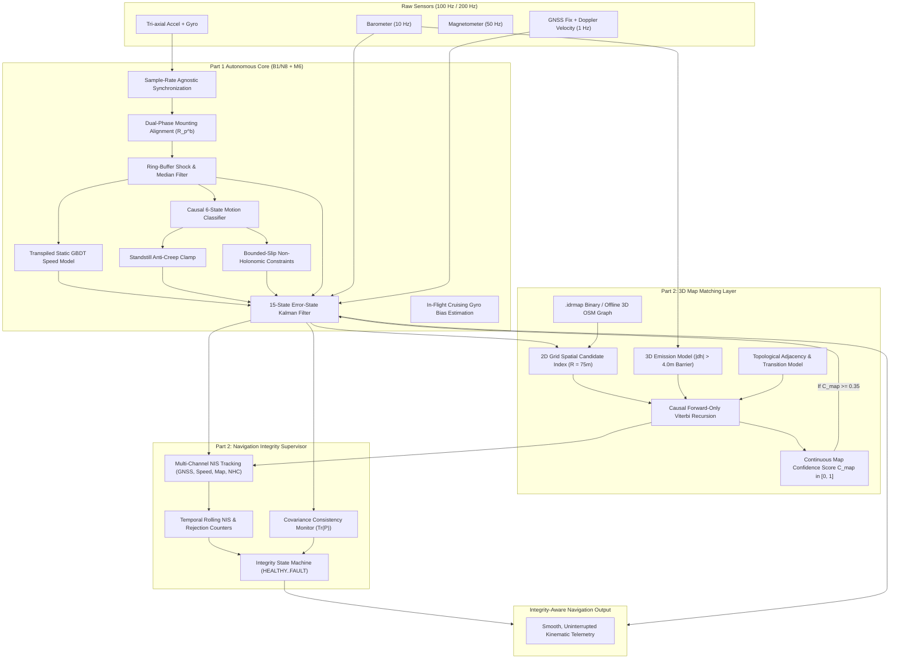
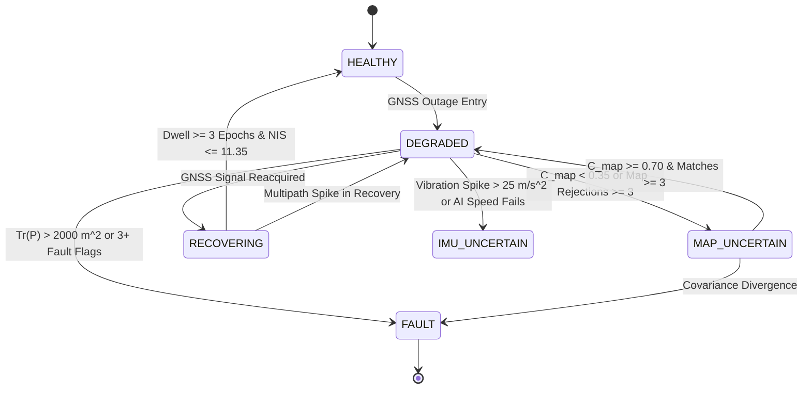

# PART 2 ARCHITECTURE SPECIFICATION
## SIH 2026 / ISRO-SAC PS 26168: AI-ML Based Intelligent Dead Reckoning System
### Intelligent 3D Map Matching + Robustness + Integrity

**Document Version:** 1.0.0  
**Phase:** Part 2 of 3  
**Status:** Validated Architecture Specification  
**Baseline:** B1/N8 + M6 Autonomous Dead-Reckoning Core  
**Core Deliverable:** C++17 Zero-Allocation Engine (`idr-core/`) + Python Reference (`idr_pipeline/`, `idr_map/`)  
**Strict Firewall Constraint:** Strictly 0 Ground-Truth speed, velocity, position, or heading during outage inference.

---

## 1. System Overview & Part 2 Objectives

Part 2 builds directly upon the validated autonomous **B1/N8 + M6** Dead-Reckoning Core from Part 1, introducing:
1. **Offline 3D Road Network Graph:** Local metric Cartesian topological representation derived from OpenStreetMap with multi-level layers (`layer`, `bridge`, `tunnel`, `elevation`).
2. **Causal 3D HMM Forward Viterbi Map Matcher:** Real-time recursive state tracker operating strictly on trailing observations ($z_{0:k}$) with a 4.0 m elevation barrier.
3. **Continuous Uncertainty-Aware Map Confidence Scoring:** Multi-factor score ($C_{\text{map}} \in [0.0, 1.0]$) governing soft Kalman constraint injection into the 15-state ESKF.
4. **Centralized Navigation Integrity Supervisor (`IntegrityManager`):** Multi-channel Normalized Innovation Squared (NIS) tracking, temporal hysteresis, covariance consistency monitoring, and fault isolation.

---

## 2. Mathematical Formulation of the 3D Map Matcher

### 2.1 State Representation
At epoch $k$, let the vehicle true road location be represented by a continuous state $s_k = (e_k, l_k)$, where $e_k \in \mathcal{E}$ is an edge in the road graph $\mathcal{G} = (\mathcal{V}, \mathcal{E})$, and $l_k \in [0, L(e_k)]$ is the along-track arc length along edge $e_k$.

### 2.2 Forward Viterbi Probability Recursion
The HMM estimates the maximum a posteriori sequence of road edges up to current time $k$:
$$V_k(e_i) = \log P(\mathbf{z}_k | e_i) + \max_{e_j \in \mathcal{E}} \left[ V_{k-1}(e_j) + \log P(e_i | e_j) \right]$$
where:
- $\mathbf{z}_k = [\mathbf{p}_k^n, \psi_k, h_k]^T$: Current unconstrained dead-reckoning position, heading, and barometric altitude.
- $\log P(\mathbf{z}_k | e_i)$: 3D emission log-likelihood.
- $\log P(e_i | e_j)$: Topological transition log-probability.

### 2.3 3D Emission Likelihood with Elevation Barrier
The emission model decomposes into orthogonal physical error channels:
$$\log P(\mathbf{z}_k | e_i) = \log P_{\text{dist}}(d_{2D}) + \log P_{\text{hdg}}(d_\psi) + \log P_{\text{alt}}(\Delta h)$$
1. **Lateral Cross-Track Distance Likelihood:**
   $$\log P_{\text{dist}}(d_{2D}) = -\frac{1}{2}\left(\frac{d_{2D}}{\sigma_d}\right)^2, \quad \sigma_d = 5.0\text{ m}$$
2. **Heading Alignment Likelihood:**
   $$\log P_{\text{hdg}}(d_\psi) = -\frac{1}{2}\left(\frac{d_\psi}{\sigma_\psi}\right)^2, \quad \sigma_\psi = 0.30\text{ rad} \approx 17.2^\circ$$
   where $d_\psi = |\text{wrap\_pi}(\psi_{\text{ins}} - \psi_{\text{road}})|$.
3. **3D Elevation Likelihood & Barrier Threshold ($|\Delta h| > 4.0\text{ m}$):**
   $$\log P_{\text{alt}}(\Delta h) = \begin{cases}
   -\frac{1}{2}\left(\frac{\Delta h}{\sigma_h}\right)^2 & \text{if } |\Delta h| \le 4.0\text{ m} \quad (\sigma_h = 1.8\text{ m}) \\
   -50.0 - 5.0 \cdot (|\Delta h| - 4.0) & \text{if } |\Delta h| > 4.0\text{ m}
   \end{cases}$$
   The steep linear penalty for $|\Delta h| > 4.0\text{ m}$ drops the emission probability below $10^{-22}$, ensuring that elevated flyovers ($8.5\text{ m}$ deck height) and underlying surface roads can never cross-pollinate candidates.

### 2.4 Topological Transition Probability
For transition from edge $e_j$ to edge $e_i$:
$$P(e_i | e_j) = \begin{cases}
\exp\left(-\frac{|\Delta d_{\text{network}} - \Delta d_{\text{DR}}|}{\beta}\right) & \text{if } e_i \text{ is topologically connected to } e_j \\
10^{-7} \quad (\log P \approx -16.1) & \text{if } e_i \text{ is disconnected from } e_j
\end{cases}$$
where $\beta = 5.0\text{ m}$, preventing unphysical hops between parallel streets or across divided highways.

---

## 3. Continuous Uncertainty-Aware Map Confidence

To avoid brittle binary thresholds, the system computes a continuous multi-factor map confidence metric $C_{\text{map}} \in [0.0, 1.0]$:

$$C_{\text{map}} = \text{SpatialProb}(d_{2D}, d_\psi, \Delta h, \Delta\text{score}) \cdot \text{CovPenalty}(P_{\psi\psi}) \cdot \text{TemporalStability}(N_{\text{matches}})$$

where:
$$\text{SpatialProb} = \exp\left(-\frac{1}{2}\left(\frac{d_{2D}}{\sigma_d}\right)^2\right) \left[ 0.50 e^{-\frac{1}{2}(d_\psi/\sigma_\psi)^2} + 0.30 e^{-\frac{1}{2}(\Delta h/2.0)^2} + 0.20 \tanh\left(\frac{\Delta\text{score}}{2.0}\right) \right]$$
$$\text{CovPenalty} = \exp\left(-\frac{\max(0, P_{\psi\psi})}{0.05}\right)$$
$$\text{TemporalStability} = \min\left(1.0, 0.5 + 0.1 \cdot N_{\text{matches}}\right)$$

### Soft Constraint Injection Policy in 15-State ESKF:
- **$C_{\text{map}} \ge 0.70$ (`HIGH`):**  
  Strong soft update: $R_{\text{cross}} = (1.75\text{ m})^2$, $R_{\text{hdg}} = (0.087\text{ rad})^2 \approx (5^\circ)^2$.
- **$0.35 \le C_{\text{map}} < 0.70$ (`MEDIUM`):**  
  Weak soft update: $R_{\text{cross}} = (3.50\text{ m})^2$, $R_{\text{hdg}} = (0.174\text{ rad})^2 \approx (10^\circ)^2$.
- **$C_{\text{map}} < 0.35$ (`LOW` / `INVALID`):**  
  **No map update applied.** Position and heading remain strictly governed by the inertial propagation and kinematic constraints.

---

## 4. Centralized Navigation Integrity Supervisor (`IntegrityManager`)

### 4.1 Multi-Channel Normalized Innovation Squared (NIS)
For each measurement channel with innovation $\mathbf{r}_k = \mathbf{z}_k - \mathbf{h}(\hat{\mathbf{x}}_k)$ and innovation covariance $\mathbf{S}_k = \mathbf{H}_k \mathbf{P}_k \mathbf{H}_k^T + \mathbf{R}_k$:
$$\text{NIS}_k = \mathbf{r}_k^T \mathbf{S}_k^{-1} \mathbf{r}_k \sim \chi^2(m)$$

| Channel | Dimension ($m$) | Chi-Square Gate ($\chi^2_{0.01}$) | Description |
|---|:---:|:---:|---|
| **GNSS Position** | 3 DOF | 11.345 | Gating multipath reflections and spoofing |
| **GNSS Velocity** | 3 DOF | 9.000 | Gating Doppler outliers |
| **AI Forward Speed** | 1 DOF | 6.635 | Gating transient model prediction errors |
| **Road Heading** | 1 DOF | 9.000 | Relaxed 1-DOF road azimuth gate |
| **Road Cross-Track** | 1 DOF | 16.000 | 1-DOF road centerline projection gate |
| **Lateral / Vertical NHC**| 1 DOF | 9.000 | Gating vehicle side-slip and airborne dynamics |

### 4.2 Temporal Hysteresis & Rolling NIS
To prevent false alarms on isolated transient spikes:
- Rolling average NIS: $\overline{\text{NIS}}_k = \frac{1}{10}\sum_{i=0}^9 \text{NIS}_{k-i}$.
- Consecutive rejection limit: $N_{\text{consec}} = 5$ epochs before declaring channel fault.
- Single spikes increment the rejection counter but do not trigger full mode transition.

### 4.3 Covariance Consistency Monitor
- Evaluates total position covariance trace: $\text{Tr}(\mathbf{P}_{pp}) = P_{0,0} + P_{1,1} + P_{2,2}$.
- Threshold: $\text{Tr}(\mathbf{P}_{pp}) \le 1000\text{ m}^2$.
- Evaluates yaw standard deviation: $\sigma_\psi = \sqrt{P_{8,8}} \cdot \frac{180}{\pi} \le 45^\circ$.
- If covariance trace exceeds limits or grows unbounded, the supervisor transitions state to `FAULT` or `IMU_UNCERTAIN`.

### 4.4 Integrity State Machine

---

## 5. Offline Binary .idrmap Map Representation

The map engine relies exclusively on the versioned, compact `.idrmap` binary format:
- **Bitwise Determinism:** All fields stored in little-endian format with fixed record lengths.
- **Safety:** Dual CRC32 checksums (header bytes $[0, 112)$ and payload bytes $[128, \text{EOF})$).
- **Fast Spatial Partitioning:** 2D grid index structure with 60 m uniform cell sizing for $O(1)$ candidate retrieval.
- **Memory Footprint:** Fully loadable into RAM in $< 1.5\text{ MB}$ for regional city corridors.
- **Offline Self-Sufficiency:** Zero internet or tile server calls at runtime.

---

## 6. Strict Scientific Integrity & Causality Verification

1. **Prefix Truncation Invariance:** For any trajectory evaluated up to epoch $k$, all state estimates $\hat{\mathbf{x}}_{0:k}$, map candidate selections, and integrity decisions are strictly invariant to the existence of samples at $t > t_k$.
2. **Zero Ground-Truth Access:** Inference loops access only raw IMU, baro, and pre-outage Doppler handover memory. Active `TrajectoryOracleTrap` proxies verify zero GT access.
3. **Parity:** Python reference and C++ production implementations execute identical algorithmic logic with zero-allocation steady-state loops.
