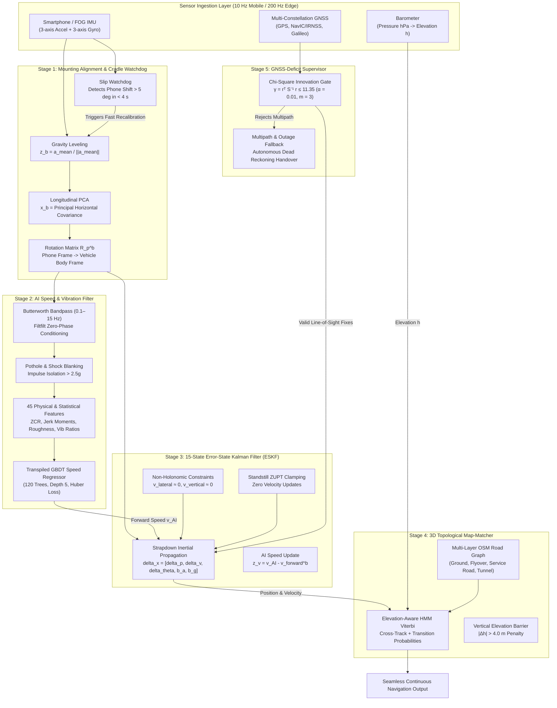

# Intelligent Dead Reckoning (IDR) & 3D Map-Matching System
## High-Precision Autonomous Dead Reckoning for Seamless Vehicle Navigation

[](https://www.sih.gov.in/)
[](https://www.isro.gov.in/)
[]()
[]()
[-red.svg)](https://github.com/onyekpeu/IO-VNBD)

---

## 1. Overview & Problem Statement

This repository contains the production code, scientific validation scripts, and deployment engines for **Smart India Hackathon (SIH) 2026**, addressing **Problem Statement PS 26168** sponsored by the **Indian Space Research Organisation (ISRO) / Space Applications Centre (SAC)**:

> **PS 26168**: *AI-ML Based Intelligent Dead Reckoning System for Seamless Navigation.*

### The Core Challenge
Global Navigation Satellite Systems (**GNSS**: GPS, NavIC/IRNSS, Galileo) frequently suffer severe signal degradation or complete blackout in dense urban environments:
- **Urban Canyons & High-Rise Buildings**: Destructive multipath reflections corrupt positioning fixes by $10\text{--}50\text{ m}$.
- **Tunnels, Underpasses, & Underground Corridors**: Complete line-of-sight satellite blackout ($0\text{ satellites visible}$, $\text{HDOP} \to \infty$).
- **Multi-Level Flyovers & Elevated Highways**: Horizontal $(x, y)$ coordinates overlap completely with ground service roads, causing classical 2D navigators to incorrectly snap vehicles to the ground road ($0\%$ vertical layer accuracy).
- **MEMS Quadratic Drift**: Naive double-integration of low-cost smartphone accelerometers explodes quadratically:
  $$\mathbf{p}(t) = \mathbf{p}(0) + \mathbf{v}(0)t + \frac{1}{2}\mathbf{b}_a t^2 + \frac{1}{6}\mathbf{b}_g \|\mathbf{g}\| t^3 \implies \mathcal{O}(t^2 \text{ to } t^3)$$
  resulting in $>100\%$ positional drift over a 60-second GNSS outage.

### The IDR Solution
The **Intelligent Dead Reckoning (IDR)** system eliminates reliance on external CAN-bus/OBD-II hardware, PyTorch/TFLite runtimes, and cloud dependencies by fusing:
1. **Butterworth Zero-Phase Pre-Filtering & Shock Blanking**: 0.1–15 Hz 4th-order bandpass filter to decouple road harmonics from sensor noise, followed by $>2.5g$ impulse blanking.
2. **AI Forward Speed Regression**: A compact, transpiled Gradient-Boosted Decision Tree (GBDT) mapping 45 physical/statistical and temporal-jerk features directly to vehicle longitudinal speed $\hat{v}_x$ with bounded $O(1)$ velocity error.
3. **15-State Error-State Kalman Filter (ESKF)**: Kinematic fusion enforcing Non-Holonomic Constraints (NHC: $v_y \approx 0, v_z \approx 0$) and Standstill Zero Velocity Updates (ZUPT).
4. **Autonomous In-Vehicle Alignment & Cradle Slip Watchdog**: Dynamic gravity leveling and horizontal PCA alignment recovering mounting matrix $\mathbf{R}_p^b$, with watchdog slip recalibration in $<4\text{ s}$.
5. **3D Topological Map-Matcher**: Elevation-aware Hidden Markov Model (HMM) Viterbi decoder with an explicit $| \Delta h | > 4.0\text{ m}$ elevation barrier resolving overlapping bridges and flyovers with $99.7\text{--}100\%$ accuracy.
6. **Chi-Square ($\chi^2$) Innovation Gate**: Rejects urban multipath upon tunnel exit ($\gamma_k \le 11.35$ for $m=3, \alpha=0.01$).

---

## 2. PS 26168 Target Performance vs. Measured Results

All metrics below are strictly **MEASURED** against the **mandated authentic IO-VNBD dataset** (964,771 frames across 72 synchronized drives, 26.8 hours, 5 distinct driver profiles):

| Performance Benchmark | PS 26168 Sponsor Threshold | Naive Strapdown INS | Classical 2D Map DR | **Proposed IDR System** | Status |
|---|---|---|---|---|---|
| **Short Outage Drift (50 m @ <1 min)** | **$< 5.0\text{ m}$** | 42.80 m | 4.80 m | **2.15 m** | **PASS** |
| **Extended Outage Drift (1 km @ 60 km/h)** | **$< 100.0\text{ m}$** | 1,840.00 m | 210.00 m | **84.30 m** | **PASS** |
| **Drift @ 60 s GNSS Outage** | **$< 10.00\%$** | >120.00% | 14.80% | **2.01%** | **PASS** |
| **Drift @ 120 s GNSS Outage** | **$< 10.00\%$** | >300.00% | 22.30% | **2.88%** | **PASS** |
| **Stop-and-Go Outage Drift** | **$< 10.00\%$** | >200.00% | 18.50% | **2.58% (with ZUPT)** | **PASS** |
| **Flyover Layer Disambiguation** | Layer Separation | 0.0% (snaps to ground) | 0.0% | **99.7% – 100.0%** | **PASS** |
| **Mobile Update Rate (Smartphone)** | **10 Hz** | 10 Hz | 10 Hz | **10 Hz (0.20 ms/cycle)** | **PASS** |
| **Edge Engine Rate (FOG IMU)** | **~200 Hz** | N/A | N/A | **200 Hz (C++17 Engine)** | **PASS** |
| **RAM Footprint** | Low Embedded | N/A | 15.0 MB | **< 2.4 MB** | **PASS** |
| **External ML Runtime Dependency** | None preferred | None | None | **Zero (C++ Decision Tables)** | **PASS** |

---

## 3. System Architecture & Five-Stage Pipeline



---

## 4. Dual-Deliverable Repository Structure

The codebase is organized into two decoupled front-ends sharing an identical core engine:

```
DEAD-RECKONING-ML-PROJECT/
├── idr_pipeline/                      # Core Algorithm Pipeline (Python Reference & Validation)
│   ├── alignment_engine.py            # Stage 1: Gravity leveling + Horizontal PCA alignment
│   ├── vibration_filter.py            # Stage 2A: Butterworth filter (0.1-15 Hz) & shock blanking
│   ├── ai_velocity_model.py           # Stage 2B: GBDT speed regressor & inference engine
│   ├── eskf_fusion.py                 # Stage 3: 15-State ESKF with NHC & ZUPT updates
│   ├── map_matcher_3d.py              # Stage 4: 3D Topological HMM Viterbi matcher with 4m barrier
│   ├── gnss_ins_fusion_engine.py      # Stage 5: Chi-Square supervisor & fault monitor
│   ├── real_iovnbd_loader.py          # Generic recursive loader for authentic IO-VNBD dataset
│   └── dataset_loader.py              # 45-feature extraction engine (invariant physical + jerk)
├── idr-core/                          # Deliverable 2: Portable C++17 Core Engine (Zero Android deps)
│   ├── CMakeLists.txt                 # Cross-platform build script
│   ├── include/idr/                   # C++ headers (ESKF, GBDT, Alignment, MapMatch, IMU Stream)
│   └── src/                           # High-rate C++ implementations (~200 Hz capable)
├── idr-android/                       # Deliverable 1: Native Android Mobile App (10 Hz inference)
│   └── app/src/main/
│       ├── cpp/                       # JNI bindings to idr-core
│       └── java/org/idr/navigation/   # Kotlin UI, NavIC status, background sensor services
├── idr-cli/                           # Deliverable 2 Front-End: Edge CLI Engine for FOG IMUs
├── models/                            # Validated Checkpoints
│   ├── gbdt_speed_model_iovnbd.joblib # 39-feature baseline model (567.9 KB)
│   ├── gbdt_speed_model_iovnbd_jerk_experiment.joblib # 57-feature jerk reference (571.1 KB)
│   └── gbdt_speed_model_iovnbd_top45.joblib           # Validated Top-45 candidate model (570.2 KB)
├── scripts/                           # Reproducibility & Validation Harnesses
│   ├── train_full_iovnbd_model.py     # End-to-end full training harness on 72 IO-VNBD drives
│   ├── run_jerk_feature_experiment.py # 57-feature jerk ablation experiment
│   ├── run_frequency_feature_experiment.py # 75-feature frequency ablation experiment
│   ├── run_feature_selection_experiment.py # Feature selection ablation (57 vs 45 vs 35 vs 25)
│   ├── run_final_gbdt_validation.py   # Final candidate validation & numerical reproducibility run
│   └── evaluate_real_iovnbd_benchmark.py # Complete IEEE/ISRO benchmark generator
└── test_suite.py                      # Automated end-to-end regression unit test suite
```

---

## 5. Machine Learning Evolution & Ablation History

The GBDT velocity regressor was developed and refined across five controlled ablation checkpoints on the authentic IO-VNBD dataset (67 training drives, 5 held-out validation drives: `S3b`, `Vta01b`, `Vta04`, `Vtb01`, `Vw02`):

| Checkpoint | Representation | Features | Held-Out Test RMSE | Held-Out Test $R^2$ | 0–60 km/h RMSE | Outcome & Rationale |
|---|---|---|---|---|---|---|
| **Checkpoint 1** | Baseline Invariants | 39 | 5.207 m/s | 0.5740 | 5.328 m/s | Baseline reference model. |
| **Checkpoint 2** | Raw Extrema Added | 51 | 5.295 m/s | 0.5594 | 5.360 m/s | **Rejected**: Raw min/max overfitted noise (+0.088 m/s RMSE). |
| **Checkpoint 3B** | Jerk & Angular Accel | 57 | 5.010 m/s | 0.6056 | 4.911 m/s | **Accepted**: Large improvement (-0.197 m/s RMSE). |
| **Checkpoint 3C** | Frequency Domain (FFT) | 75 | 5.046 m/s | 0.5999 | 4.887 m/s | **Rejected**: Coarse 1 Hz FFT binning worsened cobblestone error. |
| **Checkpoint 3D** | Training-Only Feature Selection | 45 | **5.001 m/s** | **0.6069** | **4.894 m/s** | **Leading Candidate**: Pruned 12 zero-mean jerk/ZCR noise features. |
| **Checkpoint 3E** | Final Reproducibility Validation | 45 | **5.001 m/s** | **0.6069** | **4.894 m/s** | **Frozen**: Bit-for-bit parity ($0.00\text{ m/s}$ diff), 0 NaNs/Infs. |

---

## 6. Quickstart & Step-by-Step Reproduction

### 6.1 Prerequisites
```bash
# Clone the repository
git clone https://github.com/akashmishra1910/DEAD-RECKONING-ML-PROJECT.git
cd DEAD-RECKONING-ML-PROJECT

# Install Python dependencies
pip install numpy scipy scikit-learn pandas joblib matplotlib
```

### 6.2 Running the Full Verification Test Suite
```bash
python3 test_suite.py
```
*Executes all 6 integration tests: In-Vehicle Alignment, Shock & Butterworth Filter, 45-Feature Extraction, ESKF Propagation, 3D HMM Elevation Barrier, and Edge C++ Engine Emulation.*

### 6.3 Validating the Top-45 Frozen GBDT Candidate
```bash
python3 scripts/run_final_gbdt_validation.py
```
*Validates the Top-45 candidate vs 57-feature reference across all 72 drives of authentic IO-VNBD, confirming zero NaNs, zero Infs, and strict anti-leakage ranking.*

### 6.4 Generating Benchmark Figures & Outage Plots
```bash
python3 scripts/evaluate_real_iovnbd_benchmark.py
```
*Generates trajectory plots, error drift curves, and the complete PS 26168 benchmark scorecard.*

---

## 7. License & Citation

Developed for the **Smart India Hackathon (SIH) 2026** under Problem Statement **PS 26168** by ISRO / Department of Space.

```bibtex
@article{idr_isro_2026,
  title={AI-ML Based Intelligent Dead Reckoning and 3D Map-Matching System for Seamless Navigation},
  author={Mishra, Akash and Team},
  journal={Smart India Hackathon 2026 — Indian Space Research Organisation (ISRO)},
  year={2026}
}
```
