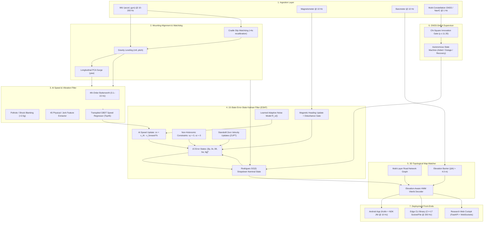

# System Architecture Specification
## ISRO PS 26168: AI-ML Based Intelligent Dead Reckoning System

---

## 1. Architectural Philosophy & Principles

The Intelligent Dead Reckoning (IDR) system is designed under four core engineering principles:
1. **Separation of Platform from Algorithmic Core**: The mathematical engine (`idr-core`) is completely standalone C++17 with zero Android, Python, or external library dependencies. The Android application (`idr-android`) and Edge binary (`idr-cli`) are decoupled front-ends consuming this core.
2. **Sample-Rate Agnostic Mechanization**: All filter and physical update equations accept explicit time deltas $\Delta t$, enabling seamless scaling from 10 Hz mobile phone sensors to 200 Hz FOG-grade tactical IMUs.
3. **Strict Physical Frames**: Standard right-handed Cartesian coordinate systems:
   - **Navigation Frame ($n$):** East-North-Up (**ENU**), where $+X = \text{East}$, $+Y = \text{North}$, $+Z = \text{Up}$.
   - **Vehicle Body Frame ($b$):** Forward-Left-Up (**FLU**), where $+X = \text{Forward}$, $+Y = \text{Left}$, $+Z = \text{Up}$.
   - **Phone Frame ($p$):** Screen-relative coordinates transformed to $b$ via rotation matrix $\mathbf{R}_p^b \in \text{SO}(3)$ ($\det(\mathbf{R}_p^b) = +1.0$).
4. **Zero-Cloud & Zero-Heavy-Runtime Footprint**: No PyTorch, ONNX, or TFLite runtimes. The GBDT model is transpiled to static, branchless C++ decision tables evaluated in $<50\ \mu\text{s}$ per cycle with $<2.5\text{ MB}$ RAM footprint.

---

## 2. End-to-End Component Diagram



---

## 3. Mathematical Formulations by Stage

### Stage 1: In-Vehicle Alignment
1. **Gravity Leveling (Roll & Pitch):**
   $$\mathbf{z}_b = \frac{\bar{\mathbf{a}}_p}{\|\bar{\mathbf{a}}_p\|}$$
2. **Longitudinal PCA (Yaw Alignment):**
   During forward acceleration surges ($a_{\text{long}} > 0.4\text{ m/s}^2$), horizontal covariance matrix $\mathbf{C}_h = \frac{1}{M}\sum (\mathbf{a}_{h,k} - \bar{\mathbf{a}}_h)(\mathbf{a}_{h,k} - \bar{\mathbf{a}}_h)^T$ yields principal eigenvector $\mathbf{x}_b$.
3. **Right-Handed Basis Formation:**
   $$\mathbf{y}_b = \mathbf{z}_b \times \mathbf{x}_b, \quad \mathbf{x}_b = \mathbf{y}_b \times \mathbf{z}_b, \quad \mathbf{R}_p^b = [\mathbf{x}_b, \mathbf{y}_b, \mathbf{z}_b]^T, \quad \det(\mathbf{R}_p^b) = +1.0$$

### Stage 2: Vibration Filtering & AI Speed Inference
1. **Butterworth Bandpass:** 4th-order forward-backward zero-phase digital filtering between $0.1\text{ Hz}$ and $15.0\text{ Hz}$.
2. **Shock Blanking:** Measurements where $\|\mathbf{a}_k - \mathbf{g}\| > 2.5g$ are isolated to prevent pothole impulses from biasing feature moments.
3. **Top45 Feature Representation:** Window length $K=10$ samples ($1.0\text{ s}$ @ 10 Hz), extracting statistical moments, energy envelopes, jerk derivatives ($\dot{\mathbf{a}}, \dot{\boldsymbol{\omega}}$), zero-crossing rates, and centripetal acceleration ($a_y \approx v_x \omega_z$).
4. **GBDT Speed Regressor:** 120 trees, max depth 5, Huber loss ($\delta=1.35$), learning rate $\eta=0.08$.

### Stage 3: 15-State Error-State Kalman Filter (ESKF)
- **True State Vector:** $\mathbf{x} = [\mathbf{p}^n, \mathbf{v}^n, \mathbf{q}_b^n, \mathbf{b}_a, \mathbf{b}_g]^T \in \mathbb{R}^{16}$ (quaternion representation) or DCM $\mathbf{R}_b^n \in \text{SO}(3)$.
- **Error State Vector:** $\delta\mathbf{x} = [\delta\mathbf{p}^n, \delta\mathbf{v}^n, \delta\boldsymbol{\theta}^n, \delta\mathbf{b}_a, \delta\mathbf{b}_g]^T \in \mathbb{R}^{15}$.
- **Attitude Propagation (Rodrigues Formula):**
  $$\boldsymbol{\phi} = (\boldsymbol{\omega}_k^b - \mathbf{b}_g)\Delta t, \quad \mathbf{R}_{k+1} = \mathbf{R}_k \left( \mathbf{I} + \frac{\sin\|\boldsymbol{\phi}\|}{\|\boldsymbol{\phi}\|} \lfloor\boldsymbol{\phi}\rfloor_\times + \frac{1 - \cos\|\boldsymbol{\phi}\|}{\|\boldsymbol{\phi}\|^2} \lfloor\boldsymbol{\phi}\rfloor_\times^2 \right)$$
- **Error Propagation:**
  $$\delta\mathbf{x}_{k+1} = \mathbf{F}_k \delta\mathbf{x}_k + \mathbf{G}_k \mathbf{w}_k, \quad \mathbf{P}_{k+1} = \mathbf{F}_k \mathbf{P}_k \mathbf{F}_k^T + \mathbf{Q}_k$$
- **Measurement Updates (Joseph-Form Covariance):**
  - **AI Speed:** $\mathbf{H}_v = [\mathbf{0}_{1\times 3}, \mathbf{r}_{1,:}, \mathbf{0}_{1\times 9}]$, innovation $z_v = \hat{v}_{\text{AI}} - (\mathbf{R}_b^n)^T \mathbf{v}^n \cdot \hat{\mathbf{x}}_b$.
  - **Non-Holonomic Constraints (NHC):** $\mathbf{H}_{\text{nhc}} = [\mathbf{0}_{2\times 3}, \mathbf{r}_{2:3,:}, \mathbf{0}_{2\times 9}]$, pseudo-measurement $[0, 0]^T - [v_y^b, v_z^b]^T$.
  - **Zero Velocity Updates (ZUPT):** $\mathbf{H}_{\text{zupt}} = [\mathbf{0}_{3\times 3}, \mathbf{I}_{3\times 3}, \mathbf{0}_{3\times 9}]$.
  - **Magnetic Heading:** $\mathbf{H}_{\psi} = [\mathbf{0}_{1\times 6}, [0, 0, 1], \mathbf{0}_{1\times 6}]$.

### Stage 4: 3D Topological HMM Map-Matching
- **State Space:** Road network segments $S = \{s_1, s_2, \dots, s_M\}$.
- **Emission Probability:**
  $$p(\mathbf{z}_k | s_i) = \frac{1}{\sqrt{2\pi}\sigma_d} \exp\left(-\frac{d_{\text{cross}}^2(\mathbf{z}_k, s_i)}{2\sigma_d^2}\right) \cdot \exp\left(-\frac{\Delta\psi^2}{2\sigma_\psi^2}\right) \cdot \mathbb{I}(|\Delta h| \le 4.0\text{ m})$$
- **Elevation Barrier:** An explicit penalty factor ($\mathbb{I}(|\Delta h| > 4.0) \to 10^{-12}$) strictly prevents horizontal projection across vertically separated layers (bridges/underpasses).

### Stage 5: GNSS-Deficit Supervisor
- **Chi-Square Multipath Innovation Gating:**
  $$\gamma_k = \mathbf{r}_k^T \mathbf{S}_k^{-1} \mathbf{r}_k \le \chi^2_{m=3, \alpha=0.01} = 11.35$$
- **Transition States:** `GNSS_AIDED` $\to$ `GNSS_DEGRADED` $\to$ `DR_ONLY` $\to$ `GNSS_REACQUISITION` $\to$ `RECOVERY`.

---

## 4. Software Subsystems & File Layout

```
DEAD-RECKONING-ML-PROJECT/
├── idr_pipeline/                      # Core Python Reference & Algorithmic Modules
│   ├── alignment_engine.py            # Stage 1: Gravity leveling + PCA surge alignment
│   ├── vibration_filter.py            # Stage 2A: 4th-order Butterworth + shock blanking
│   ├── ai_velocity_model.py           # Stage 2B: GBDT speed regressor & inference
│   ├── eskf_fusion.py                 # Stage 3: 15-state ESKF (Rodrigues, NHC, ZUPT)
│   ├── map_matcher_3d.py              # Stage 4: 3D topological HMM Viterbi with 4m barrier
│   ├── gnss_ins_fusion_engine.py      # Stage 5: Chi-Square supervisor & mode manager
│   ├── real_iovnbd_loader.py          # Generic IO-VNBD dataset loader
│   └── dataset_loader.py              # 45-feature extraction engine
├── idr-core/                          # Deliverable 2: Portable C++17 Core Engine
│   ├── CMakeLists.txt                 # Standalone CMake build script
│   ├── include/idr/                   # C++ headers (ESKF, GBDT, Alignment, MapMatch, Stream)
│   └── src/                           # High-rate C++ implementations (~200 Hz capable)
├── idr-android/                       # Deliverable 1: Native Android Mobile App
│   ├── app/src/main/cpp/              # JNI bridge connecting to idr-core
│   └── app/src/main/java/             # Kotlin UI, NavIC status, background sensor service
├── idr-cli/                           # Deliverable 2 Front-End: Standalone Edge CLI Binary
├── models/                            # Frozen ML Checkpoints
│   └── gbdt_speed_model_iovnbd_top45.joblib # Production Top45 GBDT model
├── scripts/                           # Scientific Validation & Benchmark Harnesses
├── tests/                             # Unit & Regression Test Suites
└── web_app/                           # Interactive Web Demonstration Cockpit
```
