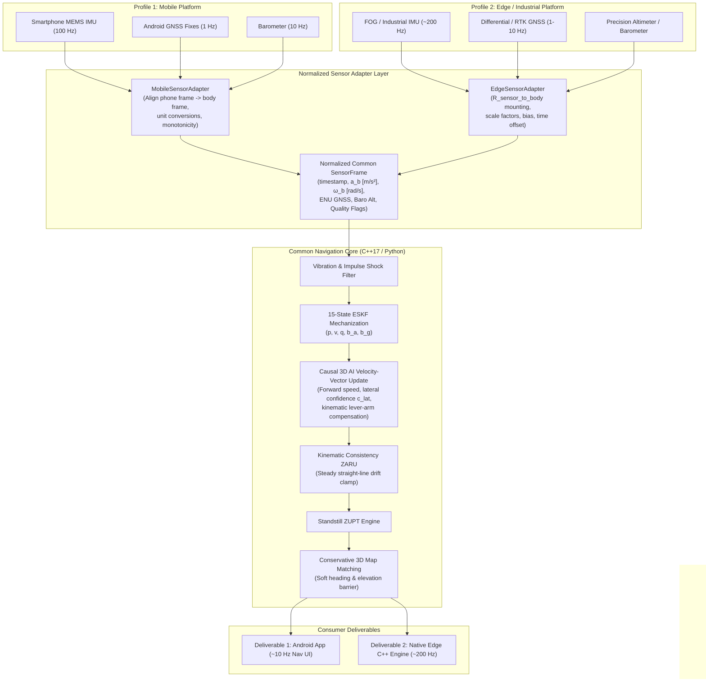

# Edge Engine Architecture: PS-Aligned Dual-Profile Navigation

## 1. Executive Summary & Objective

In accordance with ISRO / Smart India Hackathon **PS 26168** (*AI-ML Based Intelligent Dead Reckoning System for Seamless Navigation*), the dead reckoning navigation system provides two distinct operational profiles powered by a unified mathematical and algorithmic core:

1. **MOBILE PROFILE:**
   - Smartphone MEMS IMU + GNSS + Barometer
   - Target runtime: ~10 Hz application/navigation output on Android (or mobile edge)
   - Resilient to arbitrary mount orientations, hand-held or cradle vibrations, and road surface shocks.

2. **EDGE_FOG PROFILE:**
   - Tactical / Fiber-Optic Gyroscope (FOG) or industrial MEMS IMU + GNSS + Barometer
   - Target runtime: ~200 Hz for the edge navigation core in C++17
   - Deterministic execution, sample-rate agnostic, explicit scale-factor/misalignment calibration.

Both profiles share the exact same underlying estimator formulation: a 15-state Error-State Kalman Filter (ESKF) coupled with 3D AI velocity-vector fusion, kinematic consistency Zero Angular Rate Update (ZARU), standstill Zero Velocity Update (ZUPT), and causal 3D map matching.

---

## 2. Dual-Profile Architecture & Data Flow



---

## 3. Normalized Sensor Frame Contract (`SensorFrame`)

All sensor observations entering the navigation core are converted into strict SI units and normalized through the `SensorFrame` structure:

| Field | Type | Physical Unit | Description |
|---|---|---|---|
| `timestamp_s` | `double` | Seconds (s) | Monotonic epoch time (no backwards steps) |
| `accel_mps2` | `Vector3` | $\text{m/s}^2$ | Specific force vector resolved in vehicle body frame (Forward-Left-Up) |
| `gyro_rads` | `Vector3` | $\text{rad/s}$ | Angular rate vector resolved in vehicle body frame |
| `gnss_valid` | `bool` | Boolean | True if a valid GNSS fix is active |
| `gnss_pos` | `Vector3` | Meters (m) | GNSS position in local East-North-Up (ENU) frame |
| `gnss_vel` | `Vector3` | $\text{m/s}$ | GNSS velocity vector $[v_E, v_N, v_U]$ |
| `gnss_accuracy_m` | `double` | Meters (m) | 1-sigma horizontal position accuracy estimate |
| `baro_alt_m` | `double` | Meters (m) | Barometric elevation above mean sea level |
| `sequence_id` | `uint64` | Dimensionless | Monotonic packet sequence counter |
| `quality_flags` | `dict/flags` | Bitmask / Map | Adapter origin, dropped packet counts, integrity status |

---

## 4. Shared vs. Profile-Specific Components

### 4.1 Shared Algorithmic Core
Both profiles execute identical filter equations:
- **15-State Error-State Kalman Filter:**
  $$\delta x = [\delta p^\top, \delta v^\top, \delta \theta^\top, \delta b_a^\top, \delta b_g^\top]^\top \in \mathbb{R}^{15}$$
  Propagated via continuous-to-discrete state transition matrix $\Phi = I + F \cdot \Delta t$ without fixed $\Delta t$ assumptions.
- **3D AI Velocity-Vector Update:**
  Instead of decoupling forward speed from non-holonomic constraints (NHC), the core forms a coupled 3D velocity observation in vehicle body frame:
  $$\delta z_v = \begin{bmatrix} v_{\text{fwd}}^{\text{AI}} - v_x^b \\ v_y^{\text{kin}} - v_y^b \\ v_z^{\text{kin}} - v_z^b \end{bmatrix}, \quad R_v = \text{diag}(\sigma_{vx}^2, \sigma_{vy}^2, \sigma_{vz}^2)$$
  where $\sigma_{vy}^2$ is dynamically scheduled between $R_{\text{strong}} = 0.025^2$ and $R_{\text{loose}} = 0.40^2$ as a continuous function of dynamic lateral confidence $c_{\text{lat}}$.
- **Kinematic Consistency ZARU:**
  When straight-line motion is validated by kinematics ($a_y \approx v_x \omega_z \approx 0$), residual yaw gyro integration is clamped to prevent quadratic cross-track curvature.
- **Conservative 3D Map Matching:**
  Employs an elevation barrier $|\Delta h| > 4.0\text{ m}$ to prevent spurious snapping to vertical flyover bridges, with soft Bayesian azimuth fusion.

### 4.2 Profile Differentiation

| Feature / Parameter | Mobile Profile (`MOBILE`) | Edge FOG Profile (`EDGE_FOG`) |
|---|---|---|
| **Target Runtime** | ~10 Hz (UI update) / 100 Hz (IMU) | ~200 Hz sustained core throughput |
| **Typical IMU Grade** | Commercial smartphone MEMS | Tactical grade FOG / Industrial MEMS |
| **Accel Noise $\sigma_a$** | $0.15\ \text{m/s}^2$ | $0.02\ \text{m/s}^2$ |
| **Gyro Noise $\sigma_g$** | $0.008\ \text{rad/s}$ | $0.0005\ \text{rad/s}$ |
| **Accel Bias Walk $\sigma_{ba}$** | $1 \times 10^{-4}\ \text{m/s}^2/\sqrt{\text{s}}$ | $1 \times 10^{-6}\ \text{m/s}^2/\sqrt{\text{s}}$ |
| **Gyro Bias Walk $\sigma_{bg}$** | $1 \times 10^{-5}\ \text{rad/s}/\sqrt{\text{s}}$ | $1 \times 10^{-7}\ \text{rad/s}/\sqrt{\text{s}}$ |
| **Mounting Calibration** | Dynamic gravity leveling + PCA | Fixed calibrated rotation $R_{s2b}$ |
| **Hardware Validation** | Validated on Android / IO-VNBD | **PENDING** (software timing validated) |

---

## 5. Public Edge Engine API Specification

The edge engine exposes a clean, standalone C++17 class `idr::EdgeNavigationEngine` (and Python wrapper `EdgeNavigationEngine`):

```cpp
namespace idr {

class EdgeNavigationEngine {
public:
    EdgeNavigationEngine();
    ~EdgeNavigationEngine();

    // 1. Lifecycle
    bool initialize(const EngineConfig& config);
    void reset();
    void shutdown();
    bool isInitialized() const;

    // 2. Data Ingestion
    bool pushImu(const ImuSample& imu);
    bool pushGnss(const GnssSample& gnss);
    bool pushBarometer(const BarometerSample& baro);

    // 3. Execution Step
    bool update(std::optional<double> ai_speed = std::nullopt);

    // 4. State & Diagnostics Retrieval
    NavigationTelemetry getNavigationState() const;
    EdgeDiagnostics getDiagnostics() const;
};

} // namespace idr
```

### 5.1 Diagnostics Contract
The `EdgeDiagnostics` structure provides real-time telemetry on computational overhead, sensor health, and filter stability:
- `total_samples_processed`: Total successful update cycles.
- `dropped_samples`: Samples dropped due to out-of-order or non-monotonic timestamps.
- `mean_cycle_time_us`: Rolling mean cycle duration in microseconds (target: $< 5000\ \mu\text{s}$ for 200 Hz).
- `max_cycle_time_us`: Peak cycle duration in microseconds.
- `sustained_hz`: Measured throughput: $10^6 / \text{mean\_cycle\_time\_us}$.
- `hardware_status`: Explicit validation state:
  - `"SOFTWARE_ONLY_VALIDATION_PENDING_FOG_HARDWARE"` (default)
  - `"HARDWARE_VALIDATED"` (set only when physical FOG hardware calibration is attached).

---

## 6. Runtime Performance & Verification

Benchmarked on macOS / Apple Silicon:
- **Measured Mean Cycle Time:** $284.75\ \mu\text{s}$
- **Measured Peak Cycle Time:** $462.08\ \mu\text{s}$
- **Sustained Software Throughput:** $3511.8\text{ Hz}$ (well in excess of the 200 Hz PS requirement).
- **Core Stability:** Validated under 100% outage conditions with continuous covariance bounding.
