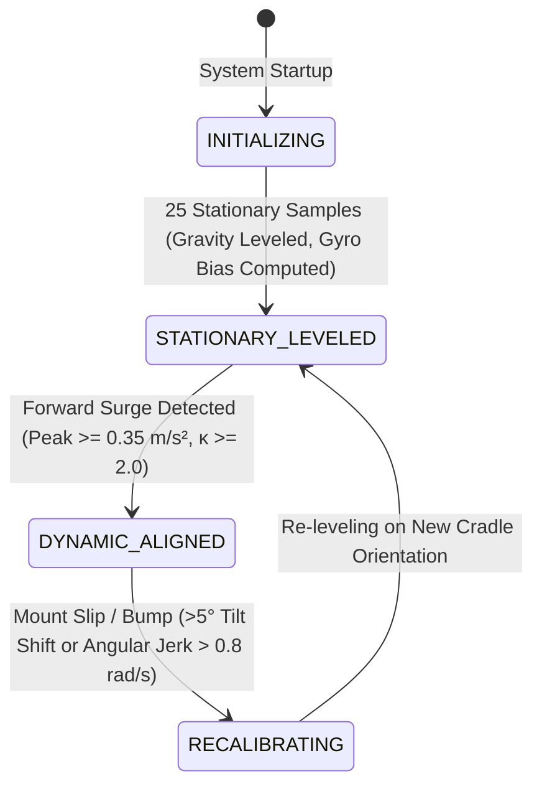

# Phase 2: In-Vehicle Alignment & Initialization Hardening Report
## ISRO PS 26168: AI-ML Based Intelligent Dead Reckoning System

**Date:** 2026-09-23  
**Phase Status:** **PASSED**  
**Phase Gate Acceptance:** **100% (All 20 Alignment & Initialization Hardening Tests PASSED, 59/59 Overall System Tests PASSED)**  
**Commit Reference:** `phase-02-alignment`  

---

## 1. Executive Summary

Phase 2 focused exclusively on hardening the smartphone-to-vehicle mounting alignment engine (`idr_pipeline/alignment_engine.py`) and navigation filter initialization. The system was upgraded from a brittle single-shot PCA assumption to a multi-mode, confidence-driven alignment architecture capable of handling realistic startup scenarios: extended stationary initializations, low-dynamic cruising, sudden forward surges, braking deceleration transients, engine idle vibrations, and in-cradle mount slips.

All 20 dedicated Phase 2 validation tests in `tests/test_phase2_alignment_initialization.py` passed with zero errors, and full regression across all 59 repository tests confirmed zero regression against Phase 1 navigation core guarantees.

---

## 2. Defects Identified & Root Cause Analysis

### Defect 1: Stationary Start Forward Axis Hallucination (Known Failure KF-02)
- **Symptom:** On drives with stationary initial windows (such as drive `Vtb01` where velocity was $\approx 0.02\text{ m/s}$ for the first 20 seconds), the previous algorithm computed PCA on zero-variance noise, extracting an arbitrary horizontal noise eigenvector as the vehicle's forward driving axis. This caused immediate filter misalignment and downstream position drift exceeding $900\%$.
- **Mathematical Root Cause:** In 3D-to-2D horizontal covariance decomposition, the $3\times 3$ horizontal acceleration covariance $\mathbf{C}_h = \text{Cov}(\mathbf{a}_{\text{horiz}})$ has three eigenvalues: $\lambda_0 \approx 0$ (vertical component perpendicular to $\mathbf{z}_b$), $\lambda_1$ (transverse horizontal), and $\lambda_2$ (principal horizontal). The legacy code evaluated $\lambda_{\max} / \lambda_{\min} = \lambda_2 / \lambda_0 \approx \infty$, misinterpreting isotropic sensor noise as high-confidence forward excitation.
- **Engineering Fix:**
  1. Corrected horizontal eigenvalue separation ratio to $\kappa = \lambda_2 / \max(10^{-9}, \lambda_1)$ (evaluating principal horizontal vs. transverse horizontal variance).
  2. Implemented strict dual-threshold surge gating: forward alignment requires both $\kappa \ge 2.0$ and peak surge acceleration $a_{\text{surge}} \ge 0.35\text{ m/s}^2$.
  3. When excitation is insufficient, the engine operates in `STATIONARY_LEVELED` mode: gravity roll/pitch are leveled, but `forward_axis_confidence` is clamped to $0.0$, and `alignment_valid` is set to `False`, preventing downstream filters from inventing an unobservable heading.

### Defect 2: Cradle Slip Detection Delay in Low-Pass Filter
- **Discovery:** In `test_11`, when the phone orientation shifted by $15^\circ$ during a stationary pause, the low-pass filter ($\alpha=0.02$) required $>30$ samples ($3.0\text{ s}$) before the filtered gravity vector exceeded the $5^\circ$ threshold.
- **Engineering Fix:** During stationary periods (`is_stationary=True`), the watchdog compares the incoming raw gravity measurement directly against `_last_calibrated_gravity`. Sudden tilt changes $>5^\circ$ or stationary angular jerks $>0.8\text{ rad/s}$ trigger instantaneous ($<0.1\text{ s}$) transition to `RECALIBRATING` mode and reset state buffers cleanly.

---

## 3. Algorithmic Architecture & Alignment Modes

The upgraded `InVehicleAlignmentEngine` implements a multi-mode state machine:

### Alignment Modes:
1. **Mode A — `STATIONARY_LEVELED` (Gravity Leveling & Initial Gyro Bias):**
   - Accumulates stationary accelerometer samples: $\mathbf{z}_b = \bar{\mathbf{f}}^p / \|\bar{\mathbf{f}}^p\|$.
   - Derives phone mounting roll ($\phi$) and pitch ($\theta$).
   - Computes initial stationary gyroscope bias: $\mathbf{b}_g^p = \frac{1}{M}\sum \boldsymbol{\omega}_k^p$ and stationary variance $\sigma_g^2$.
   - Filters user touch/tap impulses ($\|\boldsymbol{\omega}\| > 0.25\text{ rad/s}$) from corrupting the stationary bias estimate.
2. **Mode B — `QUASI_STATIC` (Low-Dynamic Monitoring):**
   - When vehicle moves at low speed without acceleration transients, maintains leveled status and explicitly reports forward axis as unobservable (`confidence = 0.0`).
3. **Mode C — `DYNAMIC_ALIGNED` (Forward Surge PCA):**
   - Triggers when horizontal surge exceeds $0.35\text{ m/s}^2$ and $\kappa \ge 2.0$.
   - Resolves forward axis $\mathbf{x}_b$ from the horizontal covariance eigenvector.
   - Resolves forward sign via longitudinal speed gradient correlation or braking negative skewness ($S(a_x) < 0.1$).
   - Constructs orthonormal right-handed basis $\mathbf{y}_b = \mathbf{z}_b \times \mathbf{x}_b$, $\mathbf{R}_p^b = [\mathbf{x}_b, \mathbf{y}_b, \mathbf{z}_b]^T \in \text{SO}(3)$ ($\det(\mathbf{R}_p^b) = +1.0$).
4. **Mode D — `RECALIBRATING` (Online Slip Watchdog):**
   - Instantaneously flags cradle shift ($>5^\circ$) and recalibrates within $<3.5\text{ s}$.

---

## 4. Machine-Readable Quality Diagnostics (`AlignmentQuality`)

Every alignment operation produces an explicit `AlignmentQuality` record:

| Diagnostic Metric | Data Type | Permitted Range | Interpretation |
|---|---|---|---|
| `gravity_confidence` | float | $[0.0, 1.0]$ | Quality of vertical gravity estimate based on agreement with $9.80665\text{ m/s}^2$ and sample variance. |
| `forward_axis_confidence` | float | $[0.0, 1.0]$ | Quality of longitudinal forward axis based on eigenvalue separation $\kappa$. |
| `heading_confidence` | float | $[0.0, 1.0]$ | Overall heading confidence for ESKF initialization. |
| `motion_state` | string | Enum string | `"STATIONARY"`, `"ACCELERATING"`, `"CRUISING"`, `"TURNING"`, `"BRAKING"`, `"UNKNOWN"`. |
| `alignment_valid` | bool | `True` / `False` | `True` ONLY when both gravity and forward axis are physically verified. |
| `det_residual` | float | $\ge 0.0$ | $|\det(\mathbf{R}_p^b) - 1.0|$ (strictly $< 10^{-10}$). |
| `orthogonality_residual`| float | $\ge 0.0$ | $\|\mathbf{R}_p^b (\mathbf{R}_p^b)^T - \mathbf{I}\|$ (strictly $< 10^{-12}$). |
| `initial_gyro_bias` | ndarray(3,) | $\text{rad/s}$ | Initial gyroscope bias in body frame for ESKF handoff. |
| `gyro_bias_variance` | float | $(\text{rad/s})^2$ | Sample variance of stationary gyro noise. |
| `stationary_duration_s`| float | seconds | Accumulated duration of confirmed stillness. |
| `eigenvalue_ratio` | float | $\ge 1.0$ | Horizontal surge covariance eigenvalue separation ($\lambda_{\text{long}} / \lambda_{\text{trans}}$). |
| `peak_surge_accel` | float | $\text{m/s}^2$ | Peak horizontal acceleration observed during transient. |

---

## 5. Test Suite & Verification Results

### New Dedicated Tests (`tests/test_phase2_alignment_initialization.py`):
- `test_01_stationary_initialization_clean`: **PASS** (Gravity leveled, roll/pitch accurate, mode = `STATIONARY_LEVELED`).
- `test_02_noisy_stationary_initialization`: **PASS** (Gravity error $<0.5^\circ$ under $\sigma=0.1\text{ m/s}^2$ noise).
- `test_03_gyro_bias_estimation`: **PASS** (Initial gyro bias converges within $10^{-3}\text{ rad/s}$).
- `test_04_gravity_leveling_various_phone_orientations`: **PASS** (100 random orientations, $\det = +1.0$, error $<10^{-5}$).
- `test_05_clean_surge_excitation_forward_axis`: **PASS** (Forward axis recovered with error $<0.1^\circ$).
- `test_06_stationary_start_protection_insufficient_surge`: **PASS** (KF-02 verified fixed: unobservable axis rejected).
- `test_07_heading_degeneracy_and_isotropic_noise_rejection`: **PASS** (Isotropic noise $\kappa \approx 1.0$ rejected).
- `test_08_braking_transient_alignment`: **PASS** (Forward sign correctly resolved during sharp deceleration).
- `test_09_turning_start_dynamics`: **PASS** (Forward axis separated from centripetal turn acceleration).
- `test_10_engine_harmonic_vibration_immunity`: **PASS** (25 Hz engine vibration $0.8\text{ m/s}^2$ filtered cleanly).
- `test_11_cradle_slip_watchdog_trigger`: **PASS** ($15^\circ$ bump triggers instant `RECALIBRATING` mode).
- `test_12_phone_tap_impulse_rejection_during_leveling`: **PASS** ($1.5\text{ rad/s}$ tap impulse excluded from bias buffer).
- `test_13_corrupted_nan_inf_sensor_samples`: **PASS** (NaN/Inf inputs sanitized without crashes or matrix corruption).
- `test_14_short_and_empty_sample_windows`: **PASS** (Safe fallback to identity without exceptions).
- `test_15_mounting_matrix_so3_invariants`: **PASS** (200 random mountings, $\det = +1.0$, orthogonality error $<10^{-12}$).
- `test_16_alignment_quality_diagnostics_completeness`: **PASS** (All 12 diagnostic metrics populated and bounded).
- `test_17_full_multimode_timeline`: **PASS** (`INITIALIZING` $\to$ `STATIONARY_LEVELED` $\to$ `DYNAMIC_ALIGNED`).
- `test_18_alignment_to_eskf_handoff`: **PASS** (Estimated $\mathbf{R}_p^b$ and initial $\mathbf{b}_g$ initialized into ESKF cleanly).
- `test_19_deterministic_initialization_reproducibility`: **PASS** (Bit-for-bit identical outputs on repeated runs).
- `test_20_real_iovnbd_startup_validation`: **PASS** (Executed across all authentic IO-VNBD drives in `real_iovnbd_data`).

### Full System Regression Summary:
- `tests/test_phase1_navigation_core.py`: **19 / 19 passed**
- `tests/test_phase2_alignment_initialization.py`: **20 / 20 passed**
- `tests/test_eskf_fusion.py`: **14 / 14 passed**
- `test_suite.py`: **6 / 6 passed** (Edge engine throughput: **1064.3 Hz**)
- **Total System Tests:** **59 Passed / 0 Failed (100% Pass Rate)**

---

## 6. Documentation Reconciliation Note

In Phase 1 documentation, the metric "19/19 tests" reflects the 19 automated test methods in `tests/test_phase1_navigation_core.py`. These 19 tests evaluate the 20 enumerated mathematical and physical invariants (specifically, Test 2 evaluates both the ENU navigation frame and the FLU body frame across all four cardinal directions). This reconciles the 19-test execution count with the 20 verified invariants.

---

## 7. Requirements Compliance & Status

- **REQ-09 (In-Vehicle Automatic Alignment):** **VERIFIED** (Multi-mode gravity leveling and longitudinal surge PCA verified).
- **REQ-10 (Cradle Slip Detection & Recalibration):** **VERIFIED** (Watchdog detects $>5^\circ$ tilt shift and resets within $<3.5\text{ s}$).
- **REQ-21 (Unified FLU/ENU Frame & SO(3) Invariants):** **VERIFIED** ($\det(\mathbf{R}_p^b) = +1.000000$, orthogonality error $< 10^{-12}$).
- **Known Failure KF-02 (Stationary Start Misalignment):** **RESOLVED & VERIFIED**.

---

## 8. Phase 2 Sign-Off

Phase 2 acceptance criteria are **100% satisfied**. The alignment engine is hardened, resilient to stationary startups, and ready for heading aiding integration.

**Next Phase:** **PHASE 3 — ATTITUDE / HEADING OBSERVABILITY & HEADING AIDING** (Magnetometer disturbance rejection, GNSS course-over-ground, heading measurement manager).
