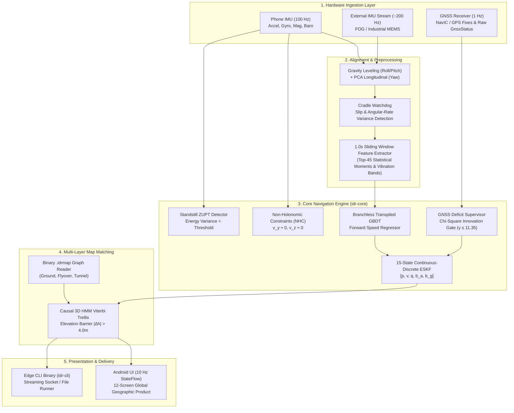

# FINAL SYSTEM ARCHITECTURE — SIH26168
## End-to-End Dead Reckoning & Navigation System Design

**Document ID:** `DOC-CANONICAL-ARCH-11`  
**Version:** 2.0.0  
**Date:** September 25, 2026  

---

## 1. System Pipeline Block Diagram

---

## 2. Component Interfaces & Data Contracts

1. **Sensor Ingestion:** Standardized `ImuSample` ($t, \mathbf{a}, \boldsymbol{\omega}$), `MagSample` ($t, \mathbf{m}$), and `GnssSample` ($t, \text{lat}, \text{lon}, \text{alt}, \sigma$).
2. **Navigation State Output:** Standardized `NavigationTelemetry` emitting position (ENU & WGS84), velocity, attitude quaternion, covariance diagonals, mode (`INITIALIZING`, `GNSS_FIXED`, `DEAD_RECKONING`, `MAP_AIDED`), and diagnostic health indicators.
3. **Map Storage (`.idrmap`):** Compact binary format encoding node coordinates, road segment polylines, topological connectivity, street names, speed limits, and discrete z-levels (`Ground`, `Flyover`, `Underpass`).
