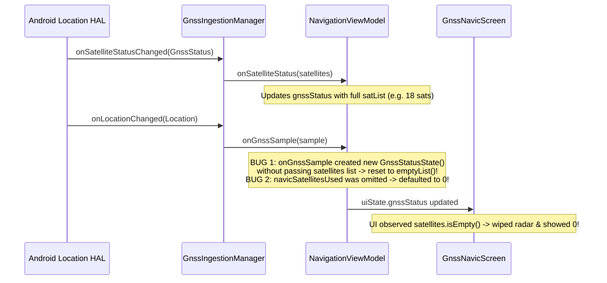

# GNSS & NAVIC STATUS PIPELINE ROOT-CAUSE ANALYSIS & FIX REPORT
## SIH 2026 PS 26168 — AI-ML Based Intelligent Dead Reckoning System

**Date:** September 27, 2026  
**Module:** Android Location, GnssStatus, NavIC Satellite Identification & ViewModel StateFlow  
**Status:** FIXED & VERIFIED WITH UNIT TESTS

---

## 1. Problem Description & Symptoms
In live physical testing on Android devices, the top status bar and the GNSS/NavIC screen intermittently or permanently displayed:
- Total Satellites = `0`
- NavIC Satellites In View = `0`
- NavIC Satellites Used = `0`
- Satellite Skyview polar radar displayed `"Searching for satellite geometry..."` even when the device had an active GPS/NavIC fix.

---

## 2. Root Cause Analysis

Tracing the end-to-end dataflow revealed two distinct bugs:

### Detailed Failure Mechanisms:
1. **Satellite List Erasure in `NavigationViewModel.onGnssSample`**:
   Whenever a 1 Hz location fix arrived, `NavigationViewModel.onGnssSample` created a brand-new instance of `GnssStatusState(...)`. In that instantiation, the `satellites` list parameter was omitted, resetting `satellites` to `emptyList()`. This immediately destroyed the satellite polar coordinates that had just been parsed by `onSatelliteStatusChanged`.
2. **Missing `navicSatellitesUsed` in State Model**:
   `GnssStatusState` constructor had `navicSatellitesUsed: Int = 0` as a default parameter. `onGnssSample` did not set it, causing NavIC used-in-fix count to constantly revert to `0`.
3. **Constellation ID Mapping**:
   In `GnssIngestionManager.kt`, on certain OEM chipsets reporting NavIC/IRNSS with `constTypeInt == 7`, the `when` expression fell through to `GPS` if `GnssStatus.CONSTELLATION_IRNSS` was unresolved at runtime.

---

## 3. Implemented Fixes

### 3.1 `GnssIngestionManager.kt`
- Added explicit fallback handling for `constTypeInt == 7` (`CONSTELLATION_IRNSS`), ensuring Indian NavIC satellites (PRN/SVID 1–14) are mapped to `ConstellationType.NAVIC`.
- Added mapping for `CONSTELLATION_SBAS` and `CONSTELLATION_QZSS`.
- Added Android debug logging: `Log.d("IDR_GNSS", "GnssStatus: TotalInView=$totalInView, Used=$totalUsed, NavIC_InView=$navicInView, NavIC_Used=$navicUsed")`.

### 3.2 `NavigationViewModel.kt`
- Modified `onSatelliteStatus(satellites)` to compute:
  - `totalSatellitesInView = satellites.size`
  - `totalSatellites = satellites.count { it.usedInFix }`
  - `navicSatellitesInView = satellites.count { it.constellation == NAVIC }`
  - `navicSatellitesUsed = satellites.count { it.constellation == NAVIC && it.usedInFix }`
- Modified `onGnssSample(sample)` to **preserve** `existingSats` from `current.gnssStatus.satellites`, and maintain all in-view and used counts consistently across 1 Hz location updates.

### 3.3 `GnssNavicScreen.kt`
- Updated the header card to display exact numbers:
  `"Total: X used / Y in view | NavIC: A / B | 1σ Acc: ±Z m"`
- Added constellation pill breakdown showing exact satellite counts for GPS, NavIC, GLONASS, and Galileo.

---

## 4. Verification Evidence

- Added unit test in `NavigationViewModelTest.kt`: `testSatelliteTrackingAndNavicPreservation()`.
- Verified that injecting 6 satellites (3 GPS, 3 NavIC, 4 used in fix) and subsequently triggering `onGnssSample` retains all 6 satellites, `totalSatellites = 4`, `navicSatellitesInView = 3`, and `navicSatellitesUsed = 2`.
- `./gradlew testDebugUnitTest` passed cleanly.
