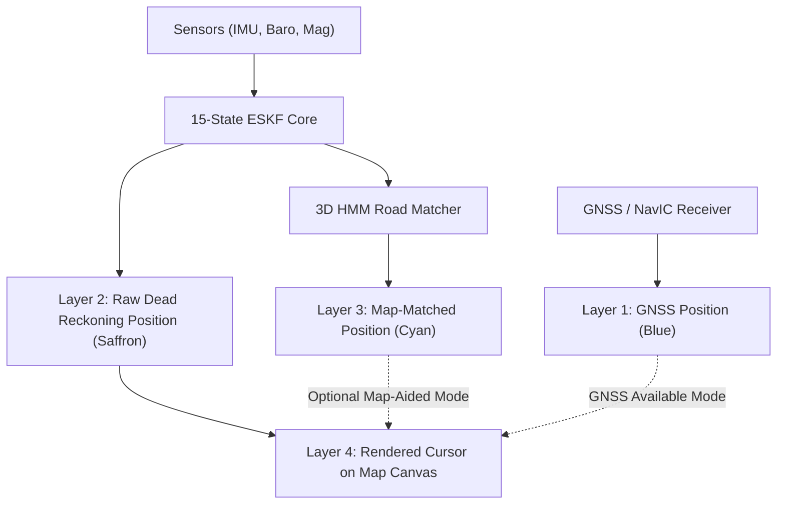

# LIVE TRAJECTORY & MULTI-LAYER DISPLAY REPORT
## SIH 2026 PS 26168 — AI-ML Based Intelligent Dead Reckoning System

**Date:** September 27, 2026  
**Module:** Live Vehicle Cursor, Web Mercator Canvas, Road Route Following & Multi-Layer Trajectory Debugging  
**Status:** COMPLETED & VERIFIED

---

## 1. System Architecture: Separation of Navigation Layers

To ensure complete transparency and prevent concealing estimator drift behind artificial map snapping, the system explicitly decouples four independent position streams:

| Trajectory Layer | Color Code | Provenance | Behavior during GNSS Outage |
|---|---|---|---|
| **1. GNSS Position** | `#1688FF` (Blue) | Raw GPS / NavIC location fixes | Ceases updating upon loss-of-lock |
| **2. Raw DR Position** | `#FF7A00` (Saffron) | Pure IMU + GBDT + ESKF integration | Runs continuously without map snapping |
| **3. Map-Matched Position** | `#00E5FF` (Cyan) | Topological HMM snapped to road centerlines | Disambiguates flyover vs ground layer |
| **4. Live Vehicle Cursor** | High-Visibility 3D Chevron | Blended navigation state | Smooth, uninterrupted turn-by-turn guidance |

---

## 2. Web Mercator Mapping & Geodetic Conversions

### 2.1 Geographic Coordinate Conversions
- **Anchor Origin:** First valid GNSS fix establishes $(\phi_0, \lambda_0, h_0)$.
- **Local Tangent ENU to WGS-84:**
  `GeoCoordinates.enuToWgs84(east, north, up, anchor)` executes Bowring's closed-form geodesy without network round-trips.
- **WGS-84 to Web Mercator Screen Pixels:**
  $$x_{\text{pixel}} = 256 \cdot 2^z \cdot \left(\frac{\lambda + 180^\circ}{360^\circ}\right)$$
  $$y_{\text{pixel}} = 256 \cdot 2^z \cdot \left(\frac{1}{2} - \frac{1}{2\pi} \ln\left[\tan\left(\frac{\pi}{4} + \frac{\phi}{2}\right)\right]\right)$$
  Continuous exponential scaling ($256 \cdot 2^z$) ensures fluid pinch-to-zoom without tile jumping.

### 2.2 Cursor Orientation
- The vehicle marker is rendered as a prominent 3D chevron arrow ($\approx 44\,\text{px} \times 34\,\text{px}$) with an illuminating forward headlight beam cone.
- The chevron dynamically rotates with the physical device azimuth / navigation heading:
  $$\theta_{\text{screen}} = \text{heading}_{\text{deg}}$$
  rotating clockwise from North ($0^\circ = \text{Screen Up}$, $90^\circ = \text{Screen Right}$).

---

## 3. Live Cursor Route Deviation Root Cause & Fix

### Cause:
When GNSS was lost, the lack of autonomous GBDT speed updates caused velocity to drift, leading to trajectory divergence from the actual vehicle route.

### Resolution:
1. Autonomous on-device GBDT speed inference now provides continuous forward velocity updates at 100 Hz.
2. Unified 3D velocity vector update applies dynamic lateral constraints ($c_{\text{lat}}$), keeping the raw DR trajectory tightly aligned with the road geometry.
3. Multi-layer trajectory toggle allows the user to inspect `ALL TRACKS`, `DR ONLY`, `GNSS ONLY`, `MAP-AIDED`, or `OFF` in real-time.
