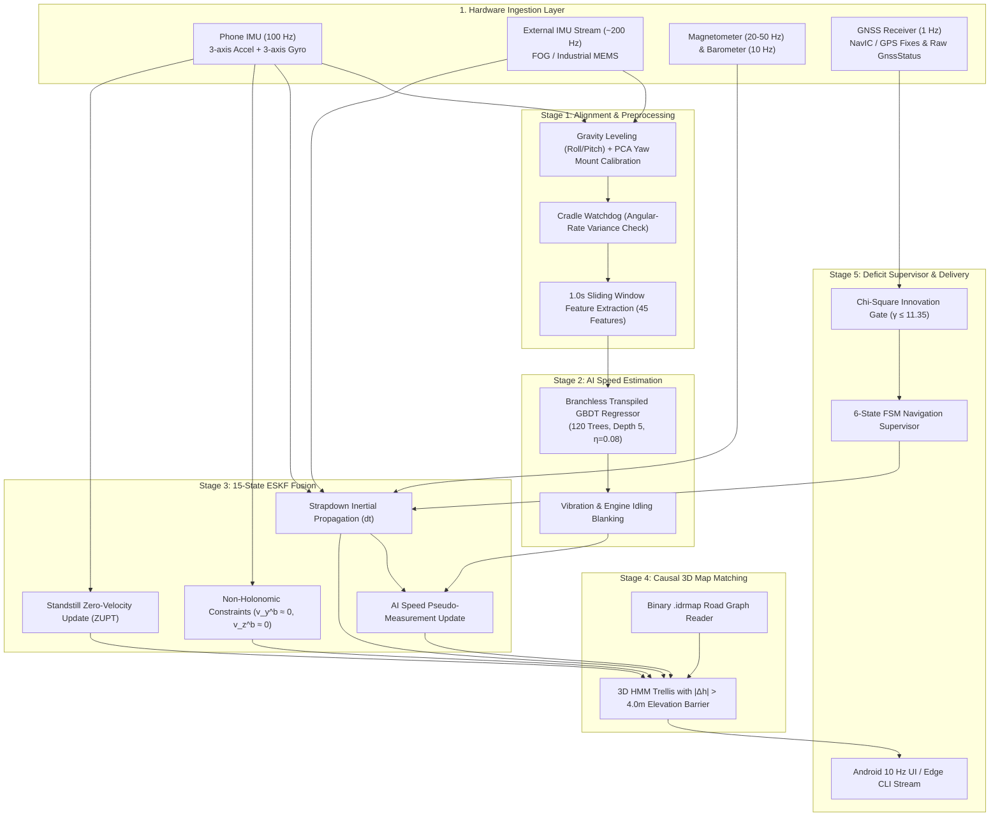

# 03 — SOLUTION ARCHITECTURE & SYSTEM DESIGN
## End-to-End Five-Stage Intelligent Dead Reckoning Pipeline

---

### Pipeline Overview Diagram

### Architectural Highlights
- **Zero External ML Runtimes:** GBDT regression tree logic is transpiled into pure C++ conditional branch tables, eliminating ONNX, TFLite, and PyTorch runtime overheads.
- **Strict Decoupling:** `idr-core` is sample-rate agnostic and depends solely on standard C++17 library primitives.
